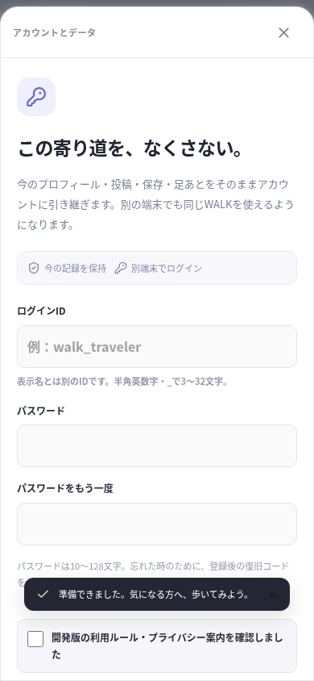
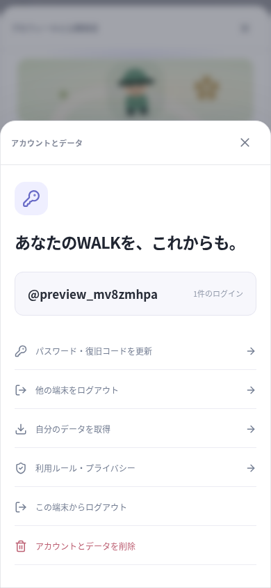

# WALKを継続して提供するための基盤

## 販売方針

ユーザーの決定は「基本無料＋任意の課金」。動画・投稿を開き、同じ趣味の人と出会う中心体験を無料で整えます。課金で投票権や住人の承認を買える仕組みは作りません。今回、ストア決済、通貨の販売、広告報酬は実装していません。

運営者名と問い合わせ先は未定です。架空の情報を埋めず、正式な規約・プライバシーのURLと運営者の確認が揃うまで、公開用の設定確認とネイティブの公開用パッケージ作成を止めます。これはストア審査を通過したことや、法的な確認を済ませたことを意味しません。

## 今回の実装

### 記録を失わずに続ける

ゲストのユーザーIDをそのままアカウント登録します。投稿・保存・リアクション・個人ルーム・足あとを別ユーザーへコピーする方式ではありません。ログインIDは表示名と別で、3〜32文字の半角英数字・`_`。パスワードは10〜128文字で、ランダムなsalt付きscrypt（N=32768、r=8、p=1）で保存します。

別端末でログインすると同じ記録に戻れます。現在のゲストに記録がある場合、他アカウントへのログインで黙って置き換えません。先にそのゲストを登録して記録を保護する必要があります。異なるユーザーの記録の自動統合はありません。

ゲストのログインは30日。登録アカウントは利用中のセッションを更新し、期限切れでも再ログインできます。無効・期限切れのCookie／ネイティブトークンから新しいゲストを黙って作らず、ログイン・復旧画面を出します。新しいゲストの作成は明示的に選びます。古いユーザーのDBデータをその操作で削除しません。

### 復旧と端末の管理

登録後に一度だけ復旧コードを表示します。160bitの乱数で、サーバーにはハッシュだけを保存します。メールによる本人確認やメールでのパスワード再設定は未実装です。パスワードと復旧コードを両方失うと、現在の実装では自動復旧できません。

復旧コードの使用・パスワード変更では古いコードと全端末のセッションを無効にし、新しいコードと現在の端末のセッションを発行します。設定から他端末をログアウトできます。WebSocketも即時に切断し、失効後の操作をサーバーが拒否します。ブラウザの別タブは、トークンを含まない変更通知で再読み込みします。

ネイティブのトークンはKeychain／暗号化ストレージで入れ替えます。パスワード・復旧コード・セッショントークンをlocalStorageへ保存しません。認証はIPとログインIDに基づいて回数制限し、DBに保持する制限情報ではIP等をハッシュ化します。

### データの取得と削除

自分のプロフィール、所有投稿、保存、リアクション、送信したメッセージ、関係、活動・メモ、部屋の配置、添付ファイルの一覧、送信した通報をJSONで取得できます。パスワード・復旧コードのハッシュ、セッション、管理者情報は含めません。画像・動画・活動写真のバイナリはJSONには含みません。画面でもその範囲を案内します。ネイティブはアプリの一時領域にファイルを作り、利用者が選ぶ保存・共有画面へ渡します。

削除には確認文字の入力、登録済みアカウントにはパスワードの再確認が必要です。本人の投稿・添付ファイル・足あと・個人ルームと、そのユーザーを含む会話・交流・ブロック・対象の通報／対応記録を削除します。相手の会話画面からも該当するデータがなくなるため、確認画面に説明します。ルームの訪問者は駅へ戻り、活動の分身・オンライン状態・閲覧状態も消えます。他人のアカウントをリクエストのIDで指定して削除するAPIはありません。

添付ファイルはまず公開アクセスを遮断し、DBと同時に削除キューへ登録します。通常はそのリクエスト中に削除し、ファイルシステムの一時的な失敗は起動時・1分ごとに再試行します。バックアップの保管・破棄は運営者の手順で別に管理します。

ブラウザから削除の入口を開くパスは `/#/delete-account`。未ログインならログインへ進み、ログイン後に削除の確認を表示します。実際の公開サーバーが決まったら、Google Play等に案内する削除URLをこのパスで作れます。localhostを公開用URLとして案内しません。

投稿の添付と活動写真の保存量は合計で1人200MBです。実機の保存先選択や、ネイティブの共有シートは別途検証が必要です。

### 通報後に対応できる

管理者は通報を未対応・対応済み・対応不要に分け、対応メモを残せます。利用停止と解除は確認理由を必要とし、対応記録を保存します。停止時は接続を切断し、投稿・ルーム・公開の分身を非表示にして通常の利用を拒否します。本人のアカウント設定、データ取得・削除は残します。解除すれば記録を削除せず再開できます。管理者権限は1時間で再認証が必要です。

これはアカウント単位の対応です。新しいゲストや別アカウントによる回避を完全に防ぐ仕組みではありません。公開運用では監視・通報の応答体制や悪用への追加対策が必要です。通報の自動判断、24時間以内の対応保証、自動での年齢確認は実装していません。

公開運用モードでは、ゲストの閲覧は残し、直接投稿・添付のアップロード・URL登録には無料のアカウント登録を必要にします。開発・既存ローカル利用では従来のゲスト投稿を維持します。

## 公開用の設定

既存の`.env`を残して、必要な項目を追加します。値をVITE変数へ移したり、リポジトリへコミットしません。

```dotenv
WALK_OPERATOR_NAME=実際の運営者名
WALK_SUPPORT_EMAIL=実際の問い合わせ先
WALK_TERMS_URL=https://実際の公開先/terms
WALK_PRIVACY_URL=https://実際の公開先/privacy
WALK_POLICY_VERSION=運営者が決めた規約のバージョン
# 実際に公開する文書を確認した後だけ設定
WALK_POLICIES_APPROVED=true
APP_ORIGIN=https://実際のWALKサーバー
COOKIE_SECURE=true
# 公開用のサーバーはこのモードで起動する
WALK_PUBLIC_RELEASE=true
```

上のURLや連絡先は説明用の記入位置で、そのまま使う値ではありません。`npm run release:check`は必要な設定を検査します。`native:release:sync`は公開HTTPSサーバーの案内APIも確認し、運営情報が未設定・未確認、または公開運用モードでないサーバー向けのパッケージ作成を拒否します。開発用の`npm run native:sync`は引き続き利用できます。

`/#/privacy` と `/#/terms` はアプリ内の利用ルール・プライバシー案内を開きます。正式文書の公開URLやApp Store／Google Playのプライバシー申告そのものを代行する機能ではありません。

## ここからの順序

| 段階 | 取り組むもの | 今の状態 |
| --- | --- | --- |
| 継続利用と運営 | アカウント、復旧、データ管理、通報対応、バックアップ | 今回実装 |
| 一緒に見る中心体験 | 同期視聴への招待・参加同意・離脱、閲覧者とグループの区別 | 直接投稿動画を対象に追加実装。[対象と制限](SYNCHRONIZED_WATCHING.md)。外部埋め込み・映画は対象外 |
| ストアのテスト配布 | 公開サーバー、運営情報、正式な規約、Android/iPhone実機、署名・ストアの申告 | 公開先と運営情報が未定。まだ配布・販売していない |
| 任意の課金 | 外観や建築関連の内容・価格、Apple/Googleの決済と復元、領収のサーバー検証 | 未実装。課金で承認・投票権を売らない |
| 住人の世界づくり | パーツ制作・持ち込み、区画承認、公共の保護・復旧 | 将来構想 |
| ゲーム内の暮らし | 自室の建築、無料コイン、住人の依頼、無料チップの遊び | [今回の実装と制限](BUILDING_AND_GAME_ECONOMY.md)。現実の仕事・物品売買・換金はユーザーの決定で対象外。広告報酬とストア課金は未実装 |

世界の階層、2.5D、同意した実閲覧者、ワンタップでの移動、活動と足あと、共有リンクは引き続き中心に置きます。架空の住人・閲覧者・人数を利用実績として追加していません。

共有は公開ルームのリンクにも対応し、承認済みの友達へ行き先を送れるようにしました。受信側が確認してから移動し、音声や同期グループには自動参加しません。[待ち合わせと公開範囲](MEETUPS_AND_ROOM_SHARING.md) を参照してください。

閲覧の公開に同意していない人は、閲覧中、他人の箱庭へ名前付きアバターの位置も配信しません。投稿の近くに移動した位置から閲覧内容を推測されることを避けます。本人には自分の分身を残し、実際の匿名閲覧人数・オンライン人数には引き続き含めます。同じユーザーの別タブで閲覧中の場合も適用します。

## 画面

以下は検証用のゲストとアカウントによる画面です。本番利用者ではありません。復旧コードやセッション情報は画面資料に含めていません。




