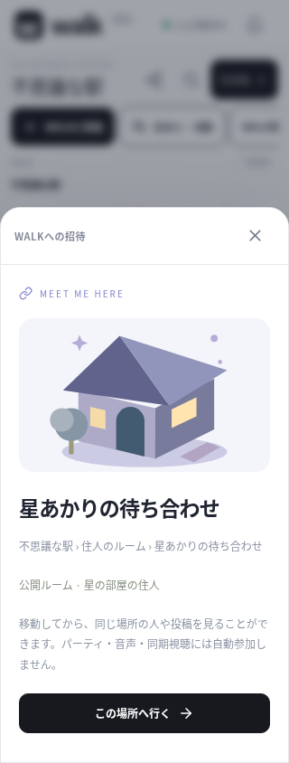
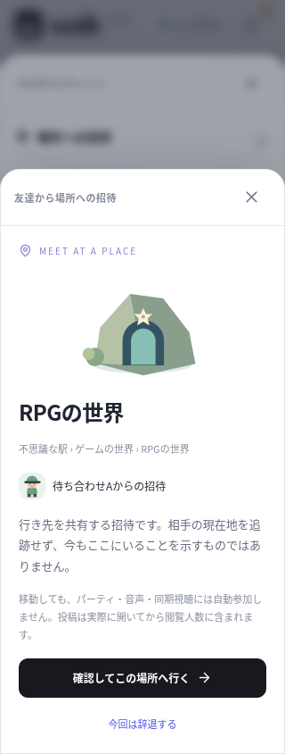

# 場所を共有して、待ち合わせる

世界・投稿に加えて、公開した個人ルームの招待リンクを作れるようにしました。個人ルーム内で共有しても、駅のリンクへ置き換えません。ルーム一覧のカードと、訪問中の「このルームに招待」から利用できます。プレビューにはルーム名・所有者・雰囲気に合わせた家のイラストを表示します。イラストはテーマの説明で、実際の配置のスクリーンショットではありません。

今回の検証は [VALIDATION_MEETUPS_2026-10-15.md](VALIDATION_MEETUPS_2026-10-15.md) に記録しています。

## 友達への行き先招待

1. 世界・投稿・公開ルームの共有画面を開きます。
2. 承認済みの友達を選んで「ここに招待」を押します。
3. 相手の通知・つながり画面へ「場所への招待」が届きます。
4. 相手が行き先を確認し、「確認してこの場所へ行く」で移動します。「今回は辞退する」も選べます。

受信・プレビュー・招待の受け付けだけで、移動や閲覧人数の加算は行いません。投稿は実際に開いた時に閲覧人数へ加えます。パーティ・マイク・同期視聴へ自動参加することもありません。それぞれの参加は別の操作です。

送るのは選んだ行き先です。送信者の名前と行き先を受信者へ表示しますが、現在地を継続配信しません。「送信者がいまもここで待っている」という表示もしません。受信・閲覧・辞退の結果を相手に知らせる既読通知は実装していません。

招待は10分間有効です。承認済みの友達・両者が閲覧できる行き先だけを対象にし、ブロック、利用停止、送信者の削除、投稿の削除、ルームの非公開化・削除があれば無効化します。同じ相手・行き先への重複送信、過度の連続送信も拒否します。招待IDを知る第三者は受け付け・辞退を操作できません。

送信者が送った後で、別の世界へ移動・ログアウトしても、選んだ行き先への招待は有効期限まで残ります。位置情報の証明や追跡として使うものではありません。送信済み一覧や送信者からの個別取り消しは未実装です。

## 公開ルームのリンク

`/#/room/<ルームのUUID>` の形式です。既存の `/#/world/<世界ID>` と `/#/post/<投稿ID>` も引き続き利用できます。リンクにはセッションや現在の検索クエリを含めません。認証情報付きURLや、不正なID・外部の転送先は共有先として受け付けません。

非公開ルームの権限をリンクで与える機能ではありません。プレビュー時に公開範囲を確認し、移動時にもサーバーで検査します。確認後に非公開になった場合は移動せず、画面に理由を残します。削除済み・非公開のリンクを開き直しても内容を表示しません。

ルーム一覧の最初の100件に入らない公開ルームでも、IDから直接読み込み、実際の部屋と配置を表示します。一覧では自分のルームを先にし、古い自分のルームが新しい他の部屋に押し出されないようにしました。並行した読み込みの古い結果で、新しい公開設定を上書きしない処理も追加しています。

移動確認に失敗した場合は、成功したように確認画面を閉じません。接続が切れている間の移動命令を保存し、再接続後に遅れて実行することも避けます。行き先の受け付け後に移動へ失敗したアプリ内招待では、同じ画面から再試行できます。移動先へのアクセス権は再試行時も検査します。

## 表示の正確さ

友達のアバターをこの世界で確認できない場合は「現在地は確認できません」と表示します。非公開で閲覧中の人に対し、不在やオフラインだと断定しません。箱庭横のアバター一覧の人数も、「○人を表示」として実際の表示件数を示します。表示できるアバターがいないことを、他の利用者が必ずいない状態として扱いません。

## 保持と配布の範囲

行き先招待は単一サーバープロセスのメモリに一時保持します。SQLite・足あと・バックアップへ履歴を追加せず、サーバーを再起動すると終了します。期限切れは送信・取得・応答時と30秒ごとの処理で整理します。通知の見た目の更新には通信時間等がかかる場合がありますが、期限切れの受け付けはサーバーで拒否します。

OSのプッシュ通知、メール、Universal Links / Android App Links、非公開ルームへの招待権限、ライブでの友達の現在地共有は今回実装していません。アプリを閉じた相手は、有効期限内に同じアカウントで再び開けば招待を確認できます。別端末での利用には共通の公開バックエンドが必要です。

ブラウザの共有リンクを、公開されていないクラウドのlocalhostで他の端末から開けるとは案内しません。ネイティブの実機共有・リンク受信・ストア公開には引き続き別の検証と設定が必要です。

## 画面

以下は320px幅のブラウザで撮影した検証用ユーザーの画面です。実機アプリの撮影や、本番利用者の記録ではありません。

