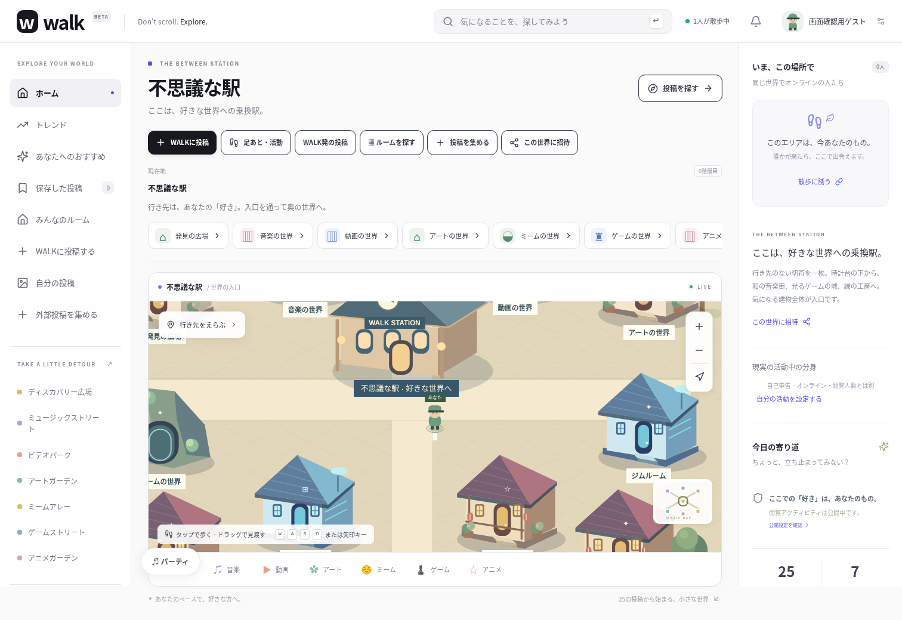
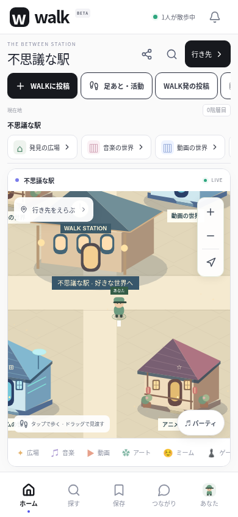
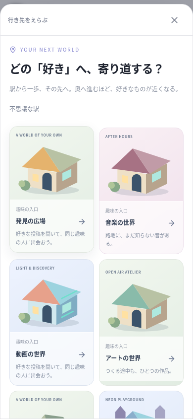
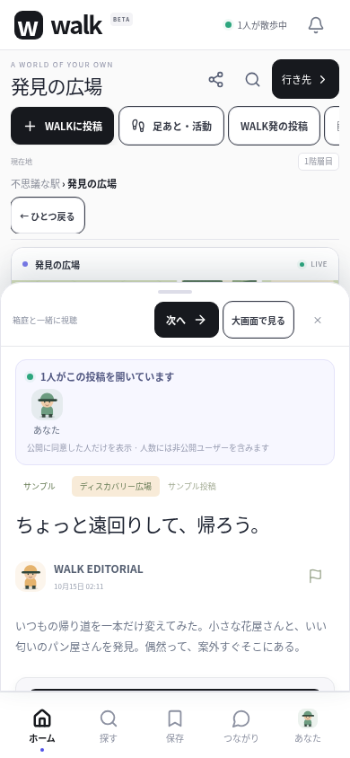

# WALKのUIと世界のデザイン

## 今回実装したもの

Instagram・Xのように投稿と人を読み取りやすい、白・黒を基本にしたSNSのUI。ロゴ、ナビゲーション、検索、余白、文字、投稿カード、視聴パネルを整理しました。選択や共有には紫のアクセントを使い、世界自体の色と競合しないようにします。既存サービスのロゴや画面素材は使っていません。

現在地のパンくずと階層数、ひとつ戻る操作、駅への帰還は共通です。スマホでは地図が残る構成にし、検索・行き先・共有を現在地のそばに置きました。操作列は横に送れます。視聴パネルでは「次へ」を上部に残し、再生条件は本文の後で畳んで表示して、投稿内容を優先します。下部ナビの選択状態は開いている画面を反映します。小さな画面の駅では初期カメラを少し引き、入口を探しやすくしています。

世界の地形や建物は既存の2.5Dベクター描画を引き継ぎ、入口判定を維持して小物と紹介を追加しました。これらは運営が用意した世界です。住人による共有世界の建築はまだ実装していません。

| 世界 | 雰囲気・デザイン | 奥への入口 |
| --- | --- | --- |
| 不思議な駅 | THE BETWEEN STATION。星空、時計台、夜行列車、暖かな窓。異なる作風をつなぐ乗換駅 | 趣味の世界と現実の活動の部屋 |
| 音楽 | AFTER HOURS。木造の路地、ランタン、小さなレコードプレーヤー | 楽器と演奏の家 |
| ゲーム | NEON PLAYGROUND。青い建物、光る窓とアーケード筐体 | RPGの洞窟 → オリジナルRPGの工房 |
| アート | OPEN AIR ATELIER。植栽、屋外のイーゼルと描きかけの絵 | 現時点では未追加 |
| アニメ | SAKURA FRAME。桜、木造の街、絵コンテのボード | アニメ制作の工房 |
| RPG | THE QUIET QUEST。石の洞窟、淡い結晶、落ち着いた紫の空 | オリジナルRPGの工房 |

人数が少ない世界では、架空の住人や数字でにぎわいを足しません。静かな場所として紹介し、自分の投稿を持ち寄ったり、リンクで友人を誘う導線を用意します。

## 招待リンク

世界と投稿のそれぞれに共有ボタンを実装しました。`/#/world/world%3Agame`、`/#/post/<投稿ID>`の形式で同じWALKサーバーへ招待します。クエリやセッション情報はリンクに含めません。受け取った人には行き先を確認する画面を表示し、「この場所へ行く」でサーバーが移動を確定します。投稿のプレビューだけでは閲覧者になりません。削除済み投稿・存在しない世界には移動しません。

ブラウザでは端末の共有メニューに対応していればそれを開き、未対応ならリンクをコピーします。コピーできない環境ではリンクを選択して手動でコピーできます。iOS・AndroidにはCapacitor Shareプラグインを組み込み、標準の共有シートを呼び出します。実機の共有シート動作は未確認です。

ネイティブから送るリンクは設定済みのHTTPSサーバーへ向かいます。受信側はブラウザで開けますが、インストール済みアプリへ直接開くUniversal Links / Android App Linksはドメインと署名の設定を含めて未実装です。localhostのリンクを別端末から開ける公開プレビューとして案内しません。共有画面にも端末限定である旨を表示します。

個人ルームの招待リンクは今回の対象外です。個人ルーム滞在中の世界招待は、共通の駅への招待になります。

## 将来構想として残すもの

- 住人による細かい世界の作成。壁・屋根・家具の組合せ、パーツ作成と外部持ち込み。
- 滞在・参加実績と既存住人の承認による住人制度。区画担当、公共の道・入口の保護、復旧。
- 人型・動物型のアバターの拡張。現在は人型とねこ・きつねの基本スタイル。
- 同期視聴の招待・同意・離脱。現在の同一投稿閲覧者表示とは別に設計する。
- 通常視聴・任意広告による通貨、購入、カジノ、仕事、取引、現実の物品売買。外部動画の報酬対象化には規約確認が必要。

投票権・承認を課金で買える仕組みは導入しません。建築や経済の先行実装より、実際に見ている人と「好き」で出会う体験を優先します。

## 画面の確認

以下はブラウザ検証で作成したゲストによる画面です。本番の利用人数ではありません。スマホ画像は390px幅のタッチ環境で、実機アプリの撮影ではありません。

