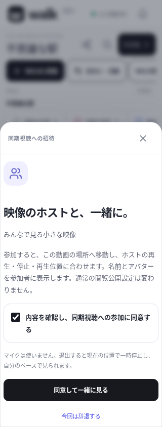
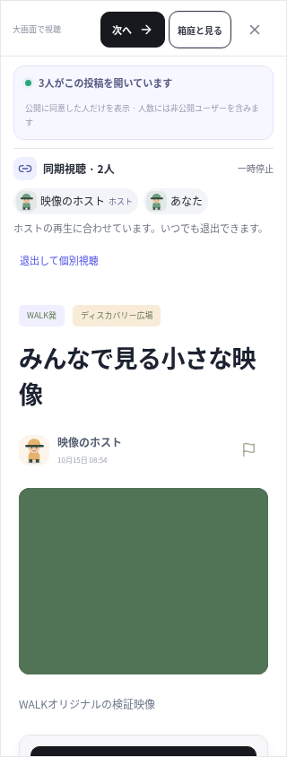

# 招待して、一緒に見る

直接アップロードしたWALKの動画と、初期提供する七つのWALKオリジナル風景映像で、ホストの再生・停止・シークに参加者の再生を合わせます。最大6人。通常の閲覧者と、参加に同意した同期グループは別に表示します。同じ投稿を開くだけで同期グループに入ることはありません。

今回の検証結果と確認できていない範囲は [VALIDATION_WATCHING_2026-10-15.md](VALIDATION_WATCHING_2026-10-15.md) に記録しています。

## 使い方

1. WALKへ直接投稿した動画かWALKのオリジナル風景映像を開き、「一緒に見る」を選びます。
2. 名前・アバターのグループ内表示と再生の同期に同意して、ホストになります。動画は一時停止から始めます。
3. ホストが承認済みの友達を招待します。招待の有効期間は2分です。
4. 相手が招待内容を確認し、同意して参加すると、その動画の場所へ移動します。招待を受け取っただけでは移動・再生・参加は起こりません。
5. ホストの再生・停止・シークを合わせます。参加者の端末で自動再生が制限されたときは、「再生を許可して合わせる」を押します。
6. 「退出して個別視聴」で現在の位置に一時停止し、通常のプレーヤーへ戻ります。その後はホストの操作に追従しません。

ホストが「同期視聴を終了」を選ぶか、視聴終了・別投稿への移動・世界移動・接続切れがあるとグループを終了します。参加者の移動・視聴終了・切断では、その参加者が離脱します。再接続しても自動で再参加しません。ホストの引き継ぎは行いません。

## 同意とプライバシー

閲覧公開の設定は変更しません。非公開閲覧の人も、同期グループへ参加した場合は名前・アバターをそのグループ内で表示します。一般の閲覧者一覧や箱庭の他人への位置配信は、従来の閲覧公開への同意に従います。参加者名は同じ動画を見る他の利用者へ一斉に公開しません。

同期人数と通常の閲覧人数を加算しません。例えば、2人が同期し、もう1人が個別視聴中なら、実閲覧人数は3人、同期グループは2人です。架空の参加者や人数は追加していません。

招待は承認済みの友達に限定し、招待IDを知るだけでは他人が参加できません。参加の同意・閲覧中の動画・空き人数・ブロックをサーバーで確認します。1ユーザーが参加できるのは1グループ・1端末です。他のタブや端末へ再生操作を転送しません。別端末からのホスト操作も拒否します。

マイクを自動で使う機能ではありません。音声は既存のパーティで、別に参加同意とマイク許可が必要です。

## 再生と終了の処理

サーバーは再生位置・再生中かどうか・サーバー時刻・更新番号を保持し、ホストの有効な操作だけを受け付けます。更新番号が古い操作や不正な数値、過度の連続操作を拒否します。映像そのものを再送信する方式ではなく、各端末が元のWALK動画を再生します。

参加時にサーバー時刻とのずれを見積もり、再生中の経過時間から目標位置を求めます。端末の再生が約0.65秒以上ずれた場合に位置を補正し、一時停止時は約0.08秒を基準に合わせます。通信遅延・端末負荷・動画の読み込みに左右され、フレーム単位の一致を保証しません。再生速度は1倍です。

ブロックがグループ内で起きると、そのグループを終了します。利用停止・アカウント削除・認証失効・動画の削除／添付の差し替えでも同期を継続しません。切断の検知にはネットワークのタイムアウトまで時間がかかる場合があります。

グループと招待は、単一サーバープロセスのメモリに一時保持します。DBやバックアップへ保存せず、サーバー再起動で終了します。ホスト以外の参加者が残っても、ホスト不在で再生操作を引き継ぎません。ネイティブでアプリが背景へ移ると退出・一時停止し、前面復帰時は個別視聴です。ブラウザで別タブを選ぶこと自体は退出条件にしません。

## 対象外と次の工程

- YouTube・TikTok等の外部埋め込み、X、映画配信は対象外です。各サービスのAPI・埋め込み制限・権利・規約を別に確認する必要があります。
- グループ全員を次の動画へ移動させる機能、ホスト交代、公開の参加リンク、再起動をまたぐグループの復元は未実装です。「次へ」は従来どおり自分の移動で、同期から離脱します。
- Android / iPhone実機での背景移動・自動再生制限・音声との併用、実ネットワーク間の遅延評価は引き続き必要です。

## 検証用映像

`tests/fixtures/walk-together.webm` は、既存のオリジナル検証映像 `walk-original.webm` を12秒に繰り返した映像です。第三者の動画を取り込んでいません。生成には `ffmpeg -stream_loop -1 -i tests/fixtures/walk-original.webm -t 12 -c copy tests/fixtures/walk-together.webm` を使用しました。

以下は320px幅のブラウザで撮影した検証用ユーザーの画面です。人数は実際に接続した3人（同期2人・個別視聴1人）によるもので、利用実績ではありません。動画は再生検証用の単色映像です。

