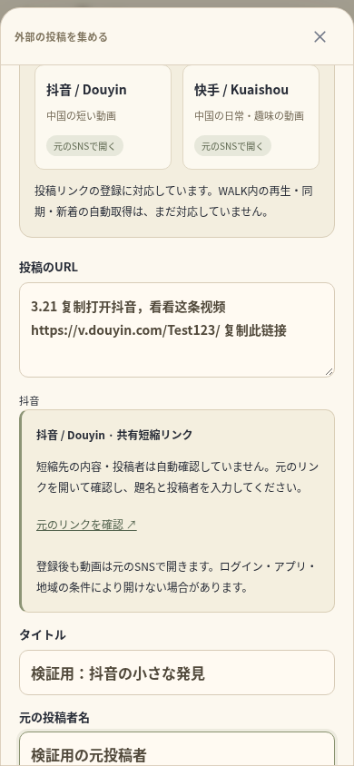
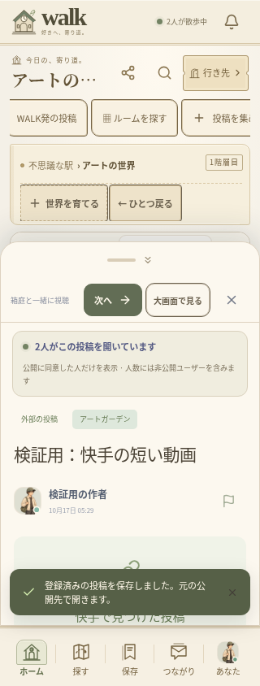

# 抖音・快手の投稿リンク — 検証記録（2026-10-17）

ユーザーが選んだ「抖音＋快手：短い動画」を優先し、共有文・通常URL・共有短縮リンクを世界へ置く入口を実装した。[対応範囲と公式連携の残り](CHINESE_SHORT_VIDEO_SOURCES.md)を参照。動画の実取得・WALK内再生ができたという記録ではない。

## 確認結果

| 項目 | 結果 |
| --- | --- |
| TypeScript・ESLint・本番Webビルド | 成功 |
| ユニット | **125件／24ファイル成功**（74.09秒）、新しい5件を含む |
| 関連するブラウザ検証 | **11件すべて成功**（1.8分）。新しい2件と既存9件、TURNによる実音声を含む |
| Capacitor | Android・iOS各6プラグインへの同期成功 |
| Android debugビルド | オフラインで成功（19秒、186タスク、21実行・165再利用） |
| 抖音・快手の公式資料・実投稿・実再生 | **通信制限で未確認** |

最初のブラウザ実行は10件成功・1件失敗。新しく作った2人向けのテストが、存在しない `.audience` を探していた。実画面には2人が表示されており、検証対象を実際の `.viewing-box` へ直した。投稿リンク向けの文言も整えた最終コードで上記11件をまとめて再実行し、すべて成功した。今回、ブラウザ全38件を実行したという意味ではない。

## 新しく検証した動作

- 抖音の通常URL・旧共有URL・`modal_id`、快手の通常URLを同じ投稿のURLへ正規化する。
- 中国語の共有文から一つのURLを取り出し、短縮コードの大文字・小文字を維持する。短縮先の動画IDを作らず、内容・作者は未確認と表示する。
- 偽ドメイン、資格情報付きURL、非標準ポート、HTTP、プロフィール・ライブの通常URL、余分なパス、複数URL、過剰な長さを拒否する。
- 390px・320pxでフォームが横にはみ出さない。題名・投稿者・ジャンル・奥の世界を選び、登録・お気に入り保存・実際のSocket移動まで行える。
- 別セッションが同じ投稿を登録すると、既存の題名・投稿者・公開先を維持して保存する。本人以外の削除は403。別ジャンルの世界への指定は投稿・保存を増やさず400になる。
- 2人が同じカードを開いた実人数を表示する。非公開設定は維持し、外部再生人数と区別する。
- 登録前後とも、画面が抖音・快手へ勝手に接続せず、iframe・videoやYouTubeのメタデータ取得を作らない。同期コントロールを出さず、動画の棚・同期の対象にも含めない。

新しい検証は独立したSQLite・本物のFastify・認証・保存・Socketを使う。URL・題名・投稿者は検証用の入力で、実在する投稿を取得したものではない。外部リンク自体をブラウザで開くことは実接続の成功として検証していない。既存YouTube検証の上流応答・埋め込みは引き続き検証用の境界である。

既存9件では、次の投稿とアバター移動、ルーム編集・公開、Xリンク登録、実WebRTC音声、オリジナルMP4の再生と同意付き同期、一人での保存・非公開ルームへの再訪、YouTube情報の確認・遅い応答・管理の候補公開を確認した。

## Androidとデータの保護

APKは **32,343,104バイト**、SHA-256は `21dadf922bb11b12adcccb721eb17edde6c3862c22cec9de2b0c57a41fd2efc5`。CRCは正常。**61個**のWeb素材のSHA-256がWeb・Android・iOS用コピー・APK内部で一致した。

新しい依存・DB移行・端末権限は追加していない。サーバーのURL判定も追加したため、この版のバックエンドへの更新が必要。ルートの別サイト、既存 `.env`・`data/`・投稿・バックアップは削除・初期化していない。

## 検証用の画面

ブラウザで撮影した実装画面。題名・作者・URLは検証用で、本番の利用実績・外部SNSの実取得・実機の画面ではない。

| 共有文の貼り付け（390px） | 2人で同じ快手の投稿カードを開く（320px） |
| --- | --- |
|  |  |

[抖音の投稿リンクを世界で開く画面（390px）](screenshots/douyin-source-390.png)

## 再実行

```sh
cd /workspace/muzui/walk
npm run typecheck
npm run lint
npm test
WALK_TEST_TURN_BIN=/workspace/.tools/walk-apt/cache/extracted/usr/bin/turnserver \
WALK_TEST_TURN_LIB=/workspace/.tools/walk-apt/cache/extracted/usr/lib/x86_64-linux-gnu \
npm run test:e2e:relay -- tests/e2e/chinese-sources.spec.ts tests/e2e/youtube-import.spec.ts tests/e2e/community.spec.ts tests/e2e/discovery.spec.ts tests/e2e/solo-time.spec.ts
```

今回の公式資料へのcurlは `open.douyin.com`・`open.kuaishou.com` ともCONNECT 403。ホストの許可追加は環境設定の下書きへ保存済みだが、保存と現在の環境への適用は別。設定の確認・保存・環境公開後の実接続、最新の公式契約・API・再生条件、実際の短縮先、iOSコンパイル、両OS実機、公開HTTPS・署名・ストア公開は残る。TLSやブラウザの管理ポリシーを変えて回避していない。
