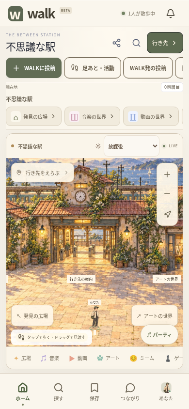
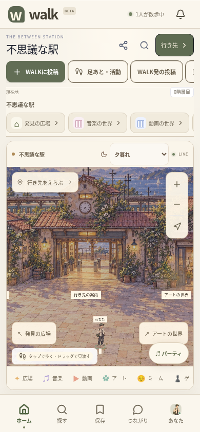
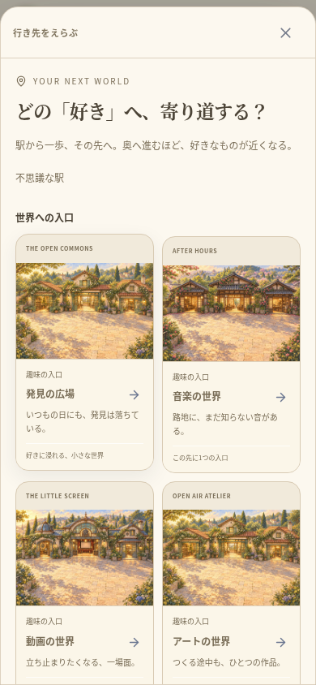
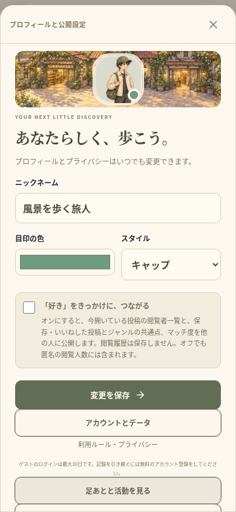
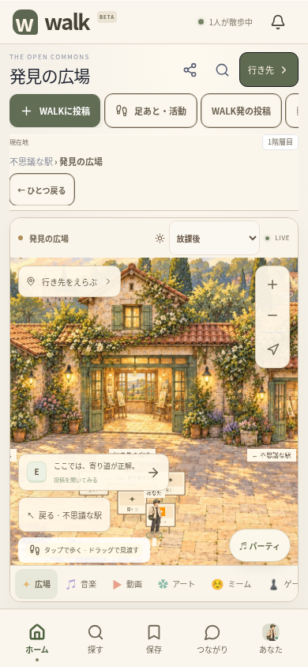
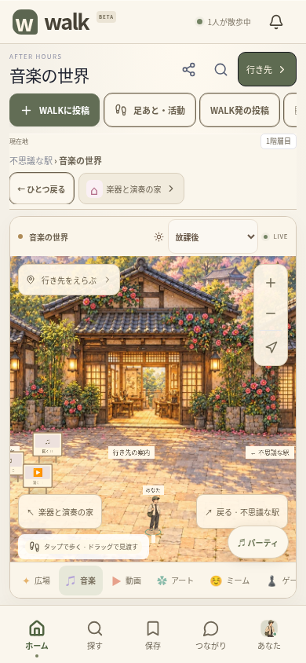
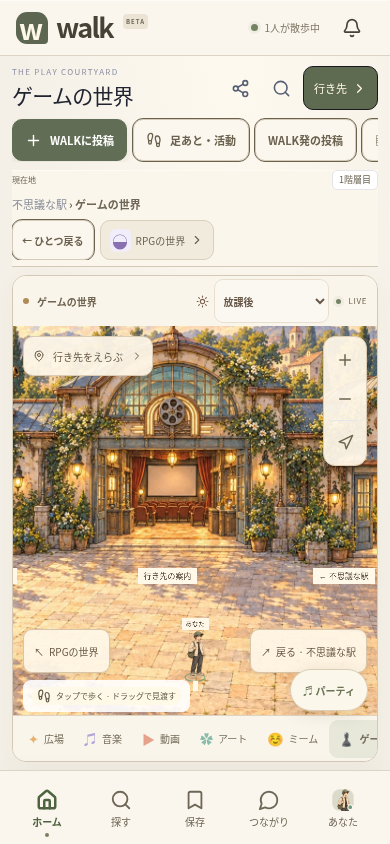
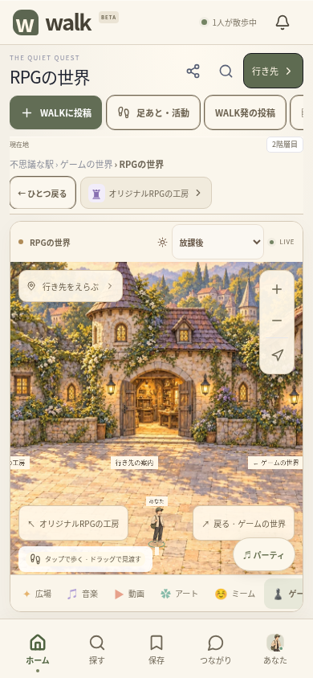
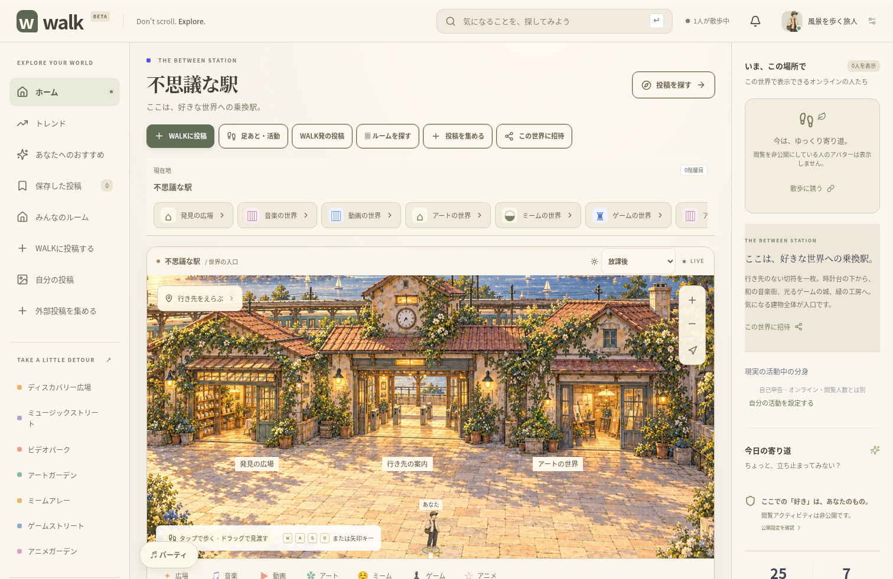

# 一体の庭と画面まわりの検証 — 2026-10-15

別々の建物・地面から一体の景色へ移行し、住人と周囲のUIを同じ画風・色へ更新した。仕様は [WORLD_GRAPHICS.md](WORLD_GRAPHICS.md)、ユーザーの追加方針は [PRODUCT_DIRECTION.md](PRODUCT_DIRECTION.md) に記録している。

## この環境で通ったもの

- Node.js 24、TypeScriptの型チェック、ESLint、ユニットテスト79件／16ファイル、Viteビルド。
- Chromiumのブラウザ検証23件すべて成功。各テスト用の一時SQLite・ゲストを使い、既存のデータ・環境ファイルを削除していない。
- PC・390pxのタッチ環境で、駅の屋根・側面・玄関・看板、時計塔と中央の案内、庭・和風・未来・RPGの戻りの建物を実際の入力で検証。ドラッグでは入室しない。
- ズーム後の投稿看板と別ユーザーの人物を、実際に見える位置でクリックして開く。保存座標から描画座標へ変換し、既存の移動・入室処理を使う。
- 駅と14の移動先で背景を読み込み、光の変更時にCanvasとユーザーの保存位置が同じであることを確認。設定をリロード後も保持。320px / 390pxで横方向にはみ出さない。
- 背景画像の取得を故意に失敗させても、ベクター描画と行き先操作が残る。
- 複数人の移動・実際の閲覧者・次への移動・保存・リアクション・承認制チャット・ブロック・通報、ルームの配置と非公開化、直接投稿と動画、招待と同意付き同期視聴、再生を保つ自室・大画面の切替、アカウントの復旧・削除、活動の分身と非公開の足あとを、既存ワークフローで確認。
- WebRTC音声はローカルTURNを経由する実際の音声で検証。このクラウドのChromium管理ポリシーは直接UDPを制限するため、ポリシーを変更せず既存のrelayハーネスを使用。
- 有限のCSSアニメーションの途中を撮らないよう撮影設定だけを調整し、画面検証3件を再実行して全件成功。アプリのアニメーションを無効にしたわけではない。
- `npx cap sync` でiOS・Androidの6プラグインと新しいWeb素材を同期。
- JDK21 / Android SDK36で `:app:assembleDebug` 成功。186タスク、21実行、165は既存の出力を再利用。
- Web・Android・iOSの `index.html`、5種類の庭、住人の透過素材のSHA-256が一致。

予備の入力検証では、テストが押す屋根の位置がPCの画面外になっているケースが1件失敗した。押す部分を画面内へパンする手順と、到着時の画角を修正した。全体23件の成功結果はその修正後の実行。駅の時計と人物が同時に入る画角、近くの看板だけの題名表示も実画面で見直した。

実行した全体検証:

```sh
cd /workspace/muzui/walk
WALK_TEST_TURN_BIN=/tmp/walk-turn/extracted/usr/bin/turnserver \
WALK_TEST_TURN_LIB=/tmp/walk-turn/extracted/usr/lib/x86_64-linux-gnu \
npm run test:e2e:relay
```

上記の `/tmp` のツールパスは、この準備済み環境で使用したもの。別の環境ではTURNの実行ファイル・共有ライブラリを用意する。API・ブラウザ検証はPlaywright設定の一時データベースを使う。

## 実際のアプリ画面

参考の一枚絵ではなく、実装を起動して撮影した画面。画面の人物・人数はテスト用ゲストの実際の状態であり、本番サービスの利用状況ではない。スマホ画像は390pxのブラウザのタッチ環境で、実機アプリの撮影ではない。

| 駅・放課後 | 駅・夕暮れ |
| --- | --- |
|  |  |

| 行き先一覧 | プロフィール |
| --- | --- |
|  |  |

| 発見の広場 | 音楽の世界 |
| --- | --- |
|  |  |

| ゲーム | RPG |
| --- | --- |
|  |  |



## 未確認・別工程

iOSのコンパイル・実機の描画速度やメモリ・長時間の利用・バックグラウンド復帰、署名とストア公開は今回の完了に含めない。5系統の静止背景であり、自由建築、骨格付き歩行、建物に沿った経路探索、カメラの自動演出は未実装。運営者情報・公開サーバー・正式な規約・課金も引き続きそれぞれの工程で扱う。

変更を `delivery/walk-local-download` にコミット・pushした。全体検証を通したアプリのコードは `b5d9de5dc841bb4669f4cda8767a688460f951d2`。続く記録の更新はドキュメントのみ。GitHubのソースZIPはアプリの起動に必要な素材・コードを含むが、ストアへ公開されたアプリやインストーラーではない。環境ファイル、ユーザーデータ、バックアップ、APKをソースZIPへ含めていない。
