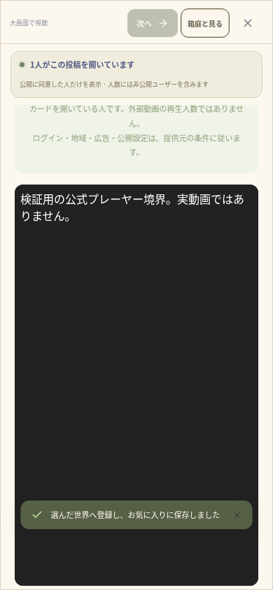

# 環境公開後・抖音公式プレーヤー — 検証記録（2026-10-17）

[実装範囲・今回読んだ公式資料](DOUYIN_PLAYER.md)を参照。環境公開後の実接続、検証用データによる画面の確認、外部動画そのものの実再生を区別する。

## 検証結果

| 検証 | 結果 |
| --- | --- |
| TypeScript・ESLint・本番ビルド | 成功 |
| ユニット | **134件／25ファイル成功**（51.04秒）、新しい9件を含む |
| 関連するブラウザ検証 | **17件成功**（2.0分）、新しい3件と既存14件、TURNによる実音声を含む |
| 新しい3件の再実行 | **3件成功**（25.3秒）。検証用iframeの文字コードを明示した後の確認 |
| Capacitor | Android・iOS各6プラグインへ同期成功 |
| Android debug APK | オフラインビルド成功（13秒、186タスク、21実行・165再利用） |
| 公式開発者資料 | 抖音・快手とも本文を実際に取得・閲覧できた |
| 実抖音API | 接続成功。資料のサンプル動画は `err_no=28003004`、WALK経由で422と案内を返した |
| 外部の実動画再生・実短縮URL展開 | **未確認** |

ブラウザ17件をまとめて実行し成功後、検証用iframeの日本語が文字化けしないよう、レスポンスとHTMLにUTF-8を明示した。製品コードは変えず、新しい3件だけ再実行した。成功したワークフローの種類は17件で、20種類や全体41件を検証したという意味ではない。

## 新しいユニット9件

認証・入力／任意ホストの拒否、未知フィールドの拒否、確認だけで投稿・保存・公開設定を変えないこと、必要情報に限定した応答、同時確認の共有・キャッシュ期限、HTTP 200でも提供元エラーを拒否すること、失敗後の再試行と資格情報の非表示、危険なHTML・異なる動画ID・外部プレーヤーの拒否を確認した。

固定の公式API URL・リダイレクト拒否・本文上限、既知の短縮ホストから通常動画のIDを得たら最終ページへ接続しないこと、HTTP・外部ホスト・資格情報・循環・動画以外への転送拒否も検証した。動画の棚では通常の抖音動画を候補にでき、未解決の短縮リンク・快手・サンプルを除外し、抖音の同期を許可しない。

## 新しいブラウザ3件

独立したSQLiteと本物のFastify・セッション・WALK API・Socket・投稿保存を使う。**抖音の成功応答・短縮リンクの解決と、外部iframeだけは検証用の境界を使用する。実際の外部動画を再生した検証ではない。** 本番HTTPや環境変数から検証用応答を有効にするスイッチは追加していない。

1. 390pxで共有文を貼り、確認操作までは外部取得せず、確認後も投稿・保存・iframeが増えない。題名を取得し、作者名は空欄のまま。通常URLへ正規化し、奥の世界へ登録・保存する。別操作で公式URLのiframeを開き、自動再生をオフ・同期なし・公開設定オフを確認。大画面へ切り替えても同じDOMのプレーヤーを維持し、320px／390pxで横にはみ出さず200pxより広いプレーヤーを表示する。閉じるとiframeを取り除く。
2. 確認中にURLを変えて古い結果を破棄する。非公開扱いの応答では成功情報やiframeを作らず、手入力の登録・元投稿リンクを維持する。後から成功した場合は再試行で公式iframeを表示する。
3. 投稿のプレーヤー確認応答を遅らせて閉じる。応答後も画面・プレーヤーを開き直さない。

既存14件では中国SNSの共有・重複登録・2人のカード閲覧人数、Xリンク・次投稿・アバター移動、WebRTC音声、オリジナルMP4の実再生と同意付き同期、個人ルーム・非公開・視点切替、一人での保存と再訪、YouTubeの確認・失敗・候補の公開を確認した。

## 実接続での観測

- `open.douyin.com`・`open.kuaishou.com` は200。JavaScriptで公式資料の本文を表示できた。保存済みの環境設定も公開版となり、実接続と合わせて反映を確認した。今回、追加の設定下書きや再公開は要求していない。
- `www.douyin.com` は200でもアクセス確認画面で、`www.kuaishou.com` は503だった。通常サイトの映像を取得できたとは扱わず、制限を回避する操作はしていない。
- 抖音の公式資料に掲載された `7471252140422401337` を、権限不要の `get_iframe_by_video` へ送るとHTTP 200・`err_no=28003004`・`非公开视频` と返った。WALKの新APIから同じ実サービスを呼び、422と案内を返すことを確認。提供元が非公開扱いとした結果であり、映像を見て状態を独自に認定したものではない。
- 同じ動画のプレーヤーHTMLは200だったが、HTMLが存在するだけで実再生の証拠にはしない。ユーザーの検証URL提出は前提にせず、公開検索でも確認用の動画URLは得られなかった。
- 快手の動画情報APIには `app_id`・OAuth・`user_video_info` が必要と公式資料で確認した。利用できるアプリ・権限・資格情報は未提供。API登録・ログインや資格情報の作成は行わず、リンク表示を維持した。

## ネイティブ・データ保護

APKは **32,344,402バイト**。SHA-256は `8cf991d33282353dd3e3484967fd2d2c3b1a5fb03b6ecbe0711802ebb0f31bd0`、CRCは正常。**61個**のWeb素材のSHA-256がWeb・Android・iOS用コピー・APK内で一致した。3件の再実行による最終Webビルドでも、同じ素材が一致することを再確認した。

依存・プラグイン・DB移行・端末権限の追加なし。ルートの別サイト、既存の `.env`・`data/`・投稿・バックアップは削除・初期化していない。クライアントとバックエンドは同じ版へ更新する必要がある。iOSのコンパイル、両OS実機、外部動画の実再生、ストア署名・公開、本番HTTPSは未確認。

## 検証用画面



実装画面を390pxのブラウザで撮影したもの。黒い枠の中は検証用HTMLであり、実際の抖音動画・本番の利用実績・実機撮影ではない。

## 再実行

```sh
cd /workspace/muzui/walk
npm run typecheck
npm run lint
npm test
WALK_TEST_TURN_BIN=/workspace/.tools/walk-apt/cache/extracted/usr/bin/turnserver \
WALK_TEST_TURN_LIB=/workspace/.tools/walk-apt/cache/extracted/usr/lib/x86_64-linux-gnu \
npm run test:e2e:relay -- tests/e2e/douyin-player.spec.ts tests/e2e/chinese-sources.spec.ts tests/e2e/youtube-import.spec.ts tests/e2e/community.spec.ts tests/e2e/discovery.spec.ts tests/e2e/solo-time.spec.ts tests/e2e/room-watching.spec.ts
```
