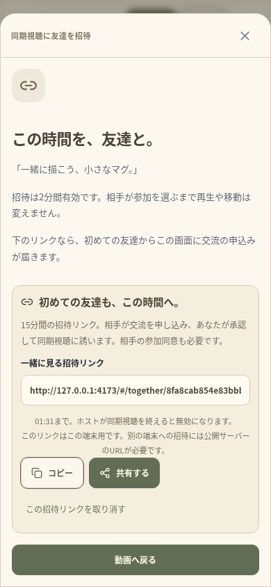
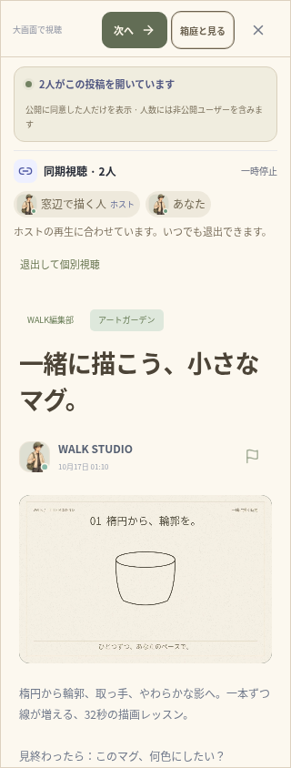

# 友達と最初の5分 — 検証記録（2026-10-17）

実装範囲は [FIRST_FIVE_MINUTES.md](FIRST_FIVE_MINUTES.md)。変更は `walk/` のみ。ルートの既存サイト、`.env`、既存の `data/`、投稿・写真・バックアップを削除・初期化していない。

## Web・サーバー

- TypeScript、ESLint、本番ビルドが成功。
- ユニットテスト **106件／21ファイル** がすべて成功。実Fastify・SQLite・Socket.IOを使う招待リンクの7件、短編の初期投入・対象判定の2件を追加。
- TURN中継を含むブラウザワークフロー **31件がすべて成功**（8.0分、失敗・スキップなし）。アカウント・通報・停止、交流・チャット、直接投稿、音声中継、個人ルーム、世界の追加、建物全体と住人の入力判定、協力ゲーム、活動・足あとも含む。
- 追加した二つのワークフローは、390px／320pxの独立したユーザーで実行。検証は独立した一時DBとサーバーを使用する。
- 全体検証の後、ホストの期限切れリンク表示を作成画面へ戻す調整を行い、TypeScript・ESLintと対象の二つのブラウザワークフローを再実行して成功した（2件、1.1分）。

## 初めての友達を招く

1. ホストが実際の短編を開き、同期への同意をしてグループを作成。別の共有同意なしではリンクを発行できない。
2. 友達がリンクから初めて来て名前を設定し、招待内容を確認。この時点では動画を開かず、閲覧人数に含まれず、交流も承認されず、同期にも参加しない。
3. 友達が名前・アバターの共有と交流の申込みに同意し、個別視聴を始める。承認待ちに同じリンクを開き直しても交流を重複作成しない。
4. ホストが交流を承認して同期に招待。友達が別途参加に同意するまで同期しない。マイクを自動開始しない。
5. H.264＋AACの実際の32秒の映像を読み込み、6秒へのシークが100ms以内で合い、ホストの操作で実再生の時刻が進み、一時停止することを確認。
6. 一般の閲覧公開設定は二人とも非公開のまま、公開の名前一覧は空。実際に投稿を開く人数は2人、同意した同期グループも別に2人。架空の閲覧者は追加しない。横にはみ出さずに操作できる。
7. ホストのバックグラウンド移行イベントでグループが終了し、相手も個別視聴へ戻り、映像が停止し、招待リンクは404になる。前面復帰でも自動再参加しない。これはブラウザからネイティブ連携イベントを送る検証で、実機OSの試験ではない。

もう一つのケースでは、交流の申込みの通信を待っている途中で確認画面を閉じる。申込みが後から成功しても動画へ勝手に移動しない。再確認中のリンクをホストが取り消すとエラーを表示し、その後も閲覧人数に加わらない。

サーバー側では15分の失効、リンクの置換・取消、別ユーザーによる取消の拒否、動画の差し替え、ブロック、ホストの退出、不正な形式・ホストの偽装・同意の欠落を検証。確認APIが返す情報は同意したホストの公開用プロフィールと投稿のID・題名・期限だけで、視聴者や位置の情報を含めない。URLトークンはハッシュだけをメモリに保存し、確認・取消の通常リクエストログを抑止する。

## 短編6本

6本とも `ffprobe` で **32秒、960×640、H.264映像＋AAC音声** を確認。2秒・12秒・23秒のデコード結果がそれぞれ異なることも確認した。アートの3本は形と色が描き足され、発見の3本は雨・灯り・湯気・紙ひこうき等と字幕で進む。サムネイルは実際に生成した映像から取得した。

描画コードと合成音から作った作品で、実写や実在の作家の制作過程の記録、他の映画・楽曲の転載ではない。提供元と説明にも明示する。人による原画制作の工程や外部作品のライセンス確認を行ったという意味ではない。各映像の最後と視聴画面には会話のきっかけになる問いを出し、回答を自動で公開しない。

初期投入は一度だけ。以前の投稿・選定番号を維持し、削除した短編を再起動で復活させないことを確認した。既存の七本の風景映像は残す。管理者による動画の選定、ジャンルの選択、有限の「次へ」も既存のワークフローで成功した。

## ネイティブ構成

`npx cap sync` が成功し、両OS各6プラグインへ同期。新しい依存パッケージや端末権限は追加していない。最終のAndroid `:app:assembleDebug` が成功（33秒、186タスク、21実行・165は出力を再利用）。APKは **32,336,692バイト**。CRCが正常で、動画とサムネイルを含む **61個** のWeb素材のSHA-256が、Web・Android・iOS用コピー・APK内部ですべて一致した。

保存済みのJDK21・SDK36・Gradle構成を使用し、Javaのネットワークは既存のプロキシ経由。TLS・署名検証や管理されたChromiumのポリシーは変更していない。素材を生成するレンダラーは任意で、通常の起動は同梱済みのMP4を使う。iOSコンパイル・実機の検証やストア用ビルドとは区別する。

## 実装画面

自動検証で動かした画面。表示する名前と人数はテストの二人によるもので、本番の利用実績ではない。ネイティブ実機の撮影でもない。画面中のlocalhostは検証環境用で、公開プレビューではない。

| 招待する側（390px） | 同意して一緒に見る側（320px） |
| --- | --- |
|  |  |

## 再実行

```sh
cd /workspace/muzui/walk
npm run typecheck
npm run lint
npm test
WALK_TEST_TURN_BIN=/workspace/.tools/walk-apt/cache/extracted/usr/bin/turnserver \
WALK_TEST_TURN_LIB=/workspace/.tools/walk-apt/cache/extracted/usr/lib/x86_64-linux-gnu \
npm run test:e2e:relay
```

初期のブラウザ検証は、グループ作成後も既に開いている招待モーダルの背後のボタンを押そうとして停止した。テストを実際のモーダルの流れに合わせ、同意や参加判定の検証は保持して全体を再実行した。

## 残る範囲

豊富なクリエイター動画や外部作品、YouTube／TikTokの同期、映画配信、課金・報酬は別工程。現在の共有リンクはWeb用で、Universal Links／App Linksは公開ドメイン・署名と合わせて実装する。公開HTTPSバックエンド、iOSコンパイル、両OSの実機・音声・着信・省電力・背景復帰、ストア署名・公開は未検証。Androidのdebugビルドを販売準備の完了とは扱わない。
