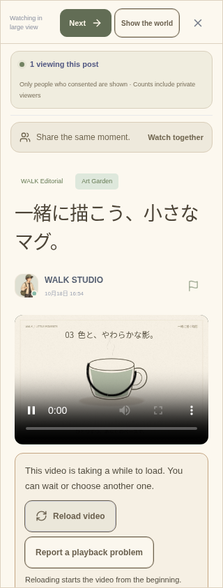

# 動画体験と公開準備の検証

2026-10-19（Asia/Tokyo）。基点 `1b0e60fd90b1c4c4fbc9a40fac2f623b26f4d9b8`。対象は `walk/`。数値・ケース名・ビルド識別子は [検証データ](verification/RELEASE_PREPARATION_2026-10-19.json)。

## 実装

- WALK内動画に準備中・バッファリング・12秒を超える待機・取得失敗・自動再生拒否の案内を追加。端末が自動再生を拒否した場合は本人がタップして再生する。再試行は明示操作で再読込し、先頭へ戻ることを説明する。
- 再生失敗・長い待機から、問題の報告、別の一本、WALK動画の棚を選べる。元の閲覧者・匿名人数・同意・同期ホストの操作権限を維持し、失敗や再生終了だけで自動移動しない。
- bilibili・抖音・YouTube・TikTokの公式プレーヤーのヘルプにも代わりの動画への導線を追加。クロスオリジンの再生結果を検出・保証したとは表示しない。抖音の再生情報を取れない場合も選び直せる。
- 窓辺の小さい画面でもWALK動画の回復操作を画面内でスクロールして使える。箱庭・大画面・窓辺の切り替えで同じメディア要素を保持する。
- `npm run release:report` を追加。秘密の値を含めずに設定状況と手作業を報告する。`-- --probe` は設定された同一HTTPSバックエンドのヘルス・公開運用メタデータだけを検査し、10秒の期限とリダイレクト拒否を使う。設定形式、実接続、実機・運営者の確認を区別する。
- 配備用イメージに不足していたバックアップ・検証・復元CLIと公開確認コマンドを含めた。保存先は非公開の永続領域内に明示指定し、既存の保存先を上書きしない。
- [公開手順](RELEASE_RUNBOOK.md)、[文書確認の材料](POLICY_REVIEW_PACKET.md)、[3言語の掲載文案](STORE_LISTING_DRAFTS.md)を追加。運用資料の古い「アカウント削除・対応状態は未実装」等の記述を現行実装へ修正した。

## 成功した確認

| 対象 | 結果 |
| --- | --- |
| 型・lint・Vite | 成功 |
| ユニット | 33ファイル・175件成功（公開レポートの新規5件を含む） |
| ブラウザ | 関連7ファイル・27件を1回の実行ですべて成功（新規7件） |
| Android | debugビルド成功、16秒・186タスク（21実行・165再利用） |
| ネイティブ画面 | Web・Android・iOS用コピー・APK内の61ファイルが一致。APKのCRC正常 |
| 配布用依存監査 | `npm audit --omit=dev` の指摘0件 |
| Docker | 更新イメージのビルドと、非rootでの起動成功 |
| コンテナの実操作 | 登録・画像添付投稿・同一識別子での再試行、再起動後の同じアカウント・投稿を確認 |
| コンテナのバックアップ | 作成・検証・別フォルダーへの復元が成功。復元したDBで別コンテナを起動し、ログイン・元の投稿ID・再試行・画像の完全一致を確認 |
| コンテナの公開確認 | 共有用レポートが鍵を含まず、未設定の正式情報を公開チェックが拒否することを確認 |

新規ブラウザ7件は、3言語それぞれの自動再生拒否と手動再生・プレーヤー保持、遅い応答から別動画へ移動して古い待機状態を持ち越さないこと、問題の送信とWALK動画への選び直し、窓辺の回復ボタン、外部公式プレーヤーからの選び直し。320pxで横溢れと44pxの窓辺ボタンを確認した。

既存20件は、初回の有限な動画キューと実再生、2ユーザーの別々の承認・同期、投稿動画の再生と管理、3言語の初回体験とアカウント、窓辺の非公開アクセス、bilibili・抖音の確認・同意・配置・リトライ等。外部プレーヤーのテストは境界をfixtureで置き換えており、新しい実サービスの再生検証ではない。WALK内の対象動画は実ファイルで再生した。

コンテナの初回検証は、再起動でランダム割当のホスト側ポートが変わり、検証側が古いポートへ接続したため止まった。再起動後の割当を取り直し、一連の操作が成功した。本番Composeは固定のループバックポートを使う。検証専用コンテナ・ボリュームは終了後に削除し、ユーザーのDB・アップロード・バックアップには触れていない。

## 再実行

```sh
cd walk
npm run typecheck
npm run lint
npm test
npx playwright test tests/e2e/playback-recovery.spec.ts tests/e2e/discovery.spec.ts tests/e2e/publishing.spec.ts tests/e2e/room-watching.spec.ts tests/e2e/international.spec.ts tests/e2e/bilibili-library.spec.ts tests/e2e/douyin-player.spec.ts
npm audit --omit=dev
npm run release:report
npm run native:sync
npm run docker:build
```

このクラウドでは信頼証明書を保持する既存の `docker:build -- --cloud` を使用した。Androidは保存済みJDK21・SDK36・Gradleで `./android/gradlew -p android --offline --no-daemon --max-workers=1 :app:assembleDebug` を実行した。新しい依存・端末権限・環境設定の追加は不要。

## 残る外部作業

公開サーバー・ドメイン、実際の運営者・問い合わせ先・正式文書・保存期間、対象年齢、Apple／Googleアカウントと署名が未確定。iOSのコンパイル・両OS実機・対象国の回線・実際のTURN・ストア提出は今回実施していない。利用できる実機の確認も未回答。公開先が未設定なので、実ホストへのprobeは行わずpendingを返した。

動画ライブラリは54本を維持した。コンテンツの権利・現地での利用条件、Douyin／Kuaishouの正式な収集権限・資格情報、継続的な新着の充実は運営者と進める必要がある。動画の原題・元の日本語字幕や編集部の説明をすべて3言語化したものではない。課金・広告報酬・建築・経済・カジノも今回まとめて公開していない。


