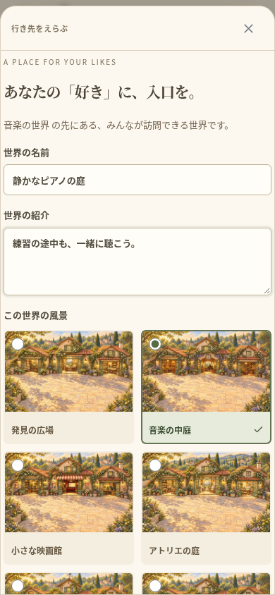
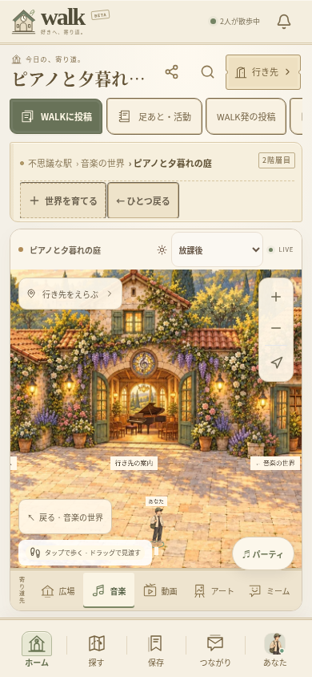

# 住人の世界と七つの風景 — 検証記録（2026-10-16）

仕様と操作は [RESIDENT_WORLDS.md](RESIDENT_WORLDS.md)。WALK以外のルートのサイトは変更していない。駅・既存のカテゴリー・細分類・投稿を残し、固定の細分類を増やさずに、住人が公開の子世界を作れるようにした。

## 確認したこと

- TypeScript・ESLintが成功。ユニットテスト85件／17ファイルが成功。停止中の世界への管理者の編集を明示的に拒否する修正後、関連6件も再実行して成功。
- 新規の世界用テストで、再起動後の階層とデータ保存、DBごとのカタログの分離、親・ジャンル・所有者の検証、他人の編集の拒否、更新競合、階層・個数の上限を確認。
- 2ユーザーが作った世界で実際に投稿を開き、匿名を含む閲覧人数と公開に同意した閲覧者を区別することを確認。他人の投稿や奥の世界がある場所の削除を拒否する。
- 空の世界の削除、滞在者の駅への退避、利用停止・復帰、データ取得JSON、作成者のアカウント削除時に別の投稿者の投稿をジャンルの入口へ残す処理を確認。
- 新規のスマホ検証は390pxと320pxの独立したセッションを使用。世界の作成、再読み込みなしでの入口の反映、訪問、自分の世界を選択した投稿フォーム、実際の同時閲覧、案内の編集、招待リンクから再訪、親への戻りと横のはみ出しを確認。
- 音声中継付きの全体ブラウザ検証26件がすべて成功（11.6分、失敗・スキップなし）。新規1件と既存25件で、投稿・動画、実閲覧者、移動とクリック判定、ルーム、フレンドとチャット、招待、実WebRTC音声、同期視聴、自室と大画面での再生継続、活動と足あと、アカウント・通報対応を確認。
- `npx cap sync` が成功。iOS・Androidの各6プラグインを同期し、HTML・JS・CSSと七つの新しい背景、合計23ファイルのSHA-256がWeb版と一致。
- Androidのdebugビルド `:app:assembleDebug` が成功（2分39秒、186タスク、23実行・163は既存の出力を再利用）。生成したAPKのCRCと、内部のHTML・JS・CSS・七つの背景23ファイルを検証し、Web版・Android・iOSの同期先と一致。

初回の対象ブラウザ検証では、移動前の古いCanvasを先に読んでしまうテストの待機と、投稿フォームのセレクトのラベル取得で失敗した。移動先の現在地を待ってから操作し、セレクトに明示的なラベルを付けて再検証した。対象4件が成功した後、音声を含む全体検証を実行。

## 実装画面

以下は実際のアプリのブラウザ撮影。人数は検証用のゲストが実際に接続した状態で、本番の利用実績ではない。ネイティブ実機の撮影とは区別する。

| 世界を作る | 作った世界を歩く |
| --- | --- |
|  |  |

七つの風景自体は `public/art/world-{discovery,music,video,art,meme,game,anime}.webp`。背景に架空の閲覧者や利用人数は描いていない。

## 再実行の手順と環境

```sh
cd /workspace/muzui/walk
npm run typecheck
npm run lint
npm test
WALK_TEST_TURN_BIN=/workspace/.tools/walk-apt/cache/extracted/usr/bin/turnserver \
WALK_TEST_TURN_LIB=/workspace/.tools/walk-apt/cache/extracted/usr/lib/x86_64-linux-gnu \
npm run test:e2e:relay
npx cap sync
cd android
JAVA_HOME=/workspace/.tools/walk-jdk21/usr/lib/jvm/java-21-openjdk-amd64 \
ANDROID_HOME=/workspace/.tools/walk-android/sdk \
ANDROID_USER_HOME=/workspace/.tools/walk-android/user \
GRADLE_USER_HOME=/workspace/.tools/walk-gradle \
python3 /workspace/.tools/walk-java-proxy.py ./gradlew --no-daemon --max-workers=1 :app:assembleDebug
```

再利用用の環境設定は `start_skill` を更新して保存済み。既存のルートサイトとWALKの起動手順を保ち、復元したツールの場所とJava用プロキシの起動方法を追記した。ドラフト保存は環境の公開とは別。

この環境では再開時に以前の `/tmp` のツールが残っていなかった。Debianの署名検証付きメタデータからcoturnと必要なライブラリを展開し、公式GoogleリポジトリのチェックサムでAndroid SDKを検証した。GradleはプロジェクトのwrapperのSHA-256検証を維持。システムのJavaは実行用のみだったため、開発用JDK21を追加した。Javaの通信には既存の環境のHTTPプロキシを使い、TLS検証を無効にしていない。

`/workspace/.tools/` は今回の環境用のローカルツール置き場で、ソースZIPに含まれない。TURNはループバックだけで起動し、テスト後に終了する。管理対象のChromiumのWebRTCポリシーは変更していない。ブラウザ検証は専用の一時SQLiteを使い、既存の `.env`、`data/`、投稿を削除していない。クラウドのlocalhostは公開プレビューではない。

## 未確認・今後の範囲

iOSのコンパイル、Android／iOS実機、ストア署名・配信、負荷試験は今回の成功に含めない。公開HTTPSバックエンド、運営者情報、正式な規約・問い合わせ先の準備も残る。世界の作成は名前・紹介・用意した景観の選択まで。自由なパーツ建築、共同管理と住人の承認、通貨・課金は将来の別工程。
