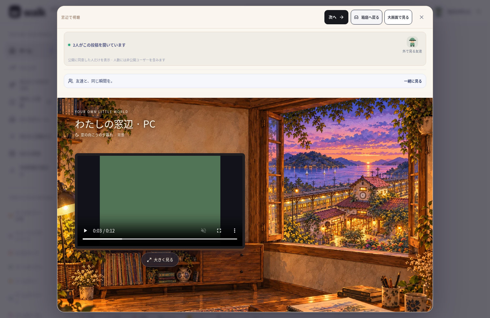
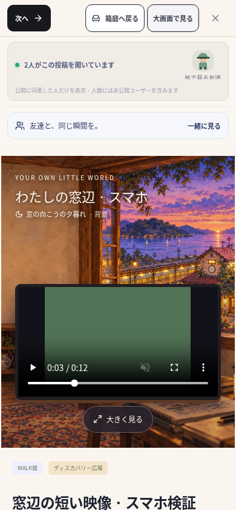

# 2026-10-15 自室の窓辺視聴の検証

Node.js 24 / Linux / Chromium。対象は `walk/` のみ。専用の一時SQLiteと検証用のゲスト・投稿・ルームを使い、既存の `data/`・`.env`・ユーザー投稿は削除・初期化していない。依存宣言・lockfile・DBスキーマ・サーバーAPIは変更していない。

## Webの結果

- TypeScriptと本番Webビルド：成功。Playwrightのサーバー開始時に `npm run build` を実行した。
- ESLint：成功。
- ユニット・API・Socket.IO：14ファイル、74件成功。
- ブラウザ全体：20件実行し19件成功、既存のWebRTC音声1件は直接接続で失敗。この環境のChromium管理ポリシーが `WebRtcIPHandling=disable_non_proxied_udp` のため、以前の検証と同じテスト用ループバックTCP TURNを用意し、該当1件を再実行して成功した。ポリシーは変更していない。
- 最後の室内レイアウト・スクロール調整後：新規の室内3件、既存の同期視聴1件、上記の音声1件を、テスト用TURN付きで実行して5件すべて成功。スキップなし。

全体回帰ではアカウント・復旧・削除・通報対応、マップのマウス／タッチ判定、場所への招待、動画投稿、共有、複数ユーザーの移動・閲覧者、チャット・ブロック、活動と足あとも検証した。音声の実際のマイク機器・異なるネットワーク間の接続は今回の結果に含めない。

## 新しい3ワークフローで確認したこと

1. PCの自室：非公開ルームに動画2本を配置し、室内の棚から実際の動画を開く。別ユーザーはその部屋を取得できず、同じ公開投稿を別の場所で開くと実閲覧人数が2人になる。公開に同意したユーザーだけがアバター一覧に現れ、部屋の持ち主の非公開設定を維持する。室内表示だけで同期グループに入らない。
2. タッチ環境でも同じ操作を実行。390px / 320pxで横にはみ出さず、動画幅を確保する。室内・大画面・箱庭で同じvideo要素を保持し、再生中の状態と一時停止した3秒の位置が維持される。「次へ」で次の実投稿へ切り替わり、以前の投稿の人数が減る。閉じるとvideoと閲覧状態を解除する。Escapeと背景の操作抑制も確認する。
3. 空のルームカードから直接「窓辺で見る」を選べる。未選択時はプレーヤー・閲覧者を作らず、配置方法と編集導線を表示する。編集ダイアログを閉じると室内へ戻れる。YouTubeの公式URLを持つiframeが室内・大画面の切替で同一要素のまま残る。

YouTubeの検証ではiframeのHTML応答をテスト用の内容へ置換し、アプリの境界と要素の保持を確認した。外部サービスでの実際の動画の再生許可・通信や、埋め込み禁止動画の再生を確認した結果ではない。直接投稿動画はテスト用WebMを実際に読み込んで再生した。

## 実装画面

検証用ゲストと検証用の12秒の動画の画面。利用人数はそのテスト内で接続した2人のもので、本番の利用状況ではない。動画の緑色の面は検証用映像の内容で、再生位置と操作は実プレーヤー。スマホ画像は390px幅のブラウザタッチ環境であり、実機撮影ではない。

## ネイティブと残る範囲

Capacitorの6プラグインを含めiOS / Androidの素材同期が成功した。Web・Android・iOSの `index.html` と、室内のWebP素材のSHA-256がそれぞれ一致した。

JDK 21 / Android SDK 36で `:app:assembleDebug` が成功した（186タスク、21実行・165既存出力を使用）。この環境ではホームが読み取り専用のため、Androidのユーザー設定先には既存の書き込み可能な `/tmp/walk-android-user` を `ANDROID_USER_HOME` で指定した。APKのビルド成功は実機での再生確認を意味しない。

iOSコンパイル・署名、Android / iPhone実機の動画・埋め込み・背景移動、ストア提出は未実施。公開HTTPSサーバーと運営者情報は未設定で、配布用リリースや公開プレビューは作成していない。窓の静止背景・家具の着せ替え等の機能範囲は [ROOM_WATCHING.md](ROOM_WATCHING.md) を参照する。
