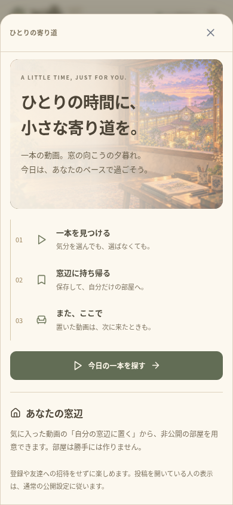
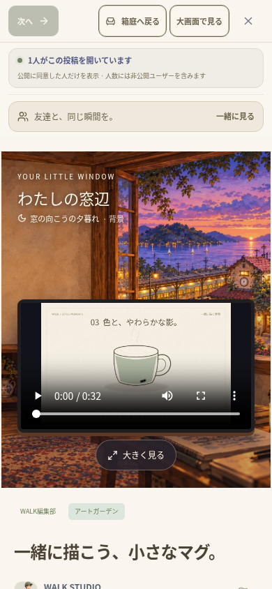

# 一人で始める時間 — 検証記録（2026-10-17）

実装範囲は [SOLO_TIME.md](SOLO_TIME.md)。変更は `walk/` のみ。ルートのサイト、`.env`、既存の `data/`、ユーザーの投稿・写真・バックアップを削除・初期化していない。前の調査で保存した外部SNS・海外市場の資料も残し、友達による試用をユーザーへ依頼する前提を外した。

## 型・サーバー・対象のブラウザ検証

- TypeScript・ESLint・本番ビルドが成功。
- ユニットテスト **112件／22ファイル** がすべて成功（62.56秒）。新しい保存・配置APIの6件を含む。
- 新しい二つの一人向けワークフローと、既存の320px／390pxの駅の操作確認の **4件がすべて成功**（53.1秒）。実際のMP4と独立した一時DBを使用する。
- TURN中継を含む全体33件を実行し、**32件が成功**（13.0分、スキップなし）。一人向けの1件は、共有のテスト用DBに他ユーザーの公開部屋もあるのに一覧全体を空と仮定して失敗した。製品コードは変更せず、本人の部屋を数えるようにテストを修正した。
- 修正後、他ユーザーの公開部屋を明示的に用意して一人向けの **2件を再実行し、両方が成功**（55.5秒）。同じ製品コードで33種類のワークフローの成功を確認した。全体を実行し直したという記録にはしていない。

APIの検証では、認証・動画の対象判定・偽装した公開設定や所有者の拒否、再試行と再起動後の保存、他ユーザーから非公開部屋を取得できないこと、既存の公開部屋の維持、装飾・テーマ・配置の維持、古いリビジョンによる編集の拒否、5部屋・40投稿の上限と失敗時のロールバックを確認した。

## 一人で実際に操作したこと

1. 名前・アカウント登録・公開への同意・友達への招待をせず、一人向けの案内を開く。これだけでは部屋を作らない。
2. 気分から実際の短編を選び、MP4の読み込みと再生時刻の進行を確認。閲覧人数は実際の一人で、名前付きの一般公開一覧は空。
3. 保存内容を確認して非公開の窓辺へ移動。お気に入りと一件の配置を保存し、本人以外の独立したセッションから部屋を取得すると404になる。同期・交流・マイクには自動参加しない。
4. 320px／390pxで横にはみ出さず、窓辺の実際の動画が260pxより広く表示されることを確認。
5. リロード後は既存仕様どおり駅に戻る。駅の一人向け入口から保存済みの部屋と動画を見つけ、同じ窓辺へ戻る。部屋・カードを重複作成しない。
6. 保存APIの応答を遅らせ、保存内容の確認画面を閉じる。明示した保存が完了しても、後から勝手に移動しない。再び操作すると既存の部屋・配置を再利用する。
7. 既存の非公開部屋の名前・装飾・テーマを維持し、公開部屋を選択肢に含めず、その公開設定や配置も変更しない。

駅の既存確認では、文字のコントラスト、44px以上の操作範囲、240pxを超える箱庭の高さ、下部ナビとの重なり、カテゴリー移動、検索、プロフィールの操作も成功した。

## 確認中の修正

駅の一人向け入口と動画の棚を一つの行にまとめ、スマホで箱庭を圧迫しにくくした。初期の新しいテストは、補足説明を含むボタンのアクセシブル名を短い題名と完全一致させて見つけられなかった。実際の名前に合わせて対象を特定した。

再訪テストも、リロード後も部屋にいると仮定していた。既存のサーバーは最後のSocket切断で現在地を破棄するため、実際の利用者と同じく駅の入口から部屋へ戻る操作に直した。現在地や閲覧履歴を新しく永続保存する変更はしていない。

通し検証では、ルーム一覧に他ユーザーの公開部屋も含まれることを新しいテストが見落としていた。本人の所有する部屋だけを数えるよう修正し、単独実行でも他ユーザーの公開部屋を作って同じ条件を検証する。公開部屋を消してテストを通す変更はしていない。

## ネイティブ構成

`npx cap sync` で両OS各6プラグインへ同期。新しい依存パッケージ・端末権限・DB移行は追加していない。保存済みのJDK21・SDK36・Gradle依存を使ったオフラインのAndroid `:app:assembleDebug` が成功（35秒、186タスク、21実行・165再利用）。

APKは **32,339,396バイト**。CRCが正常で、**61個** のWeb素材のSHA-256がWeb・Android・iOS用コピー・APK内部で一致した。iOSのコンパイルや両OS実機の起動を確認したという意味ではない。

## 実装画面

実際のブラウザ検証の画面。検証用の本人一人によるもので、架空の人気や本番の利用実績を表示していない。実機撮影・公開プレビューではない。

| 一人で始める（390px） | 自分の窓辺で見る（390px） |
| --- | --- |
|  |  |

[保存した窓辺と動画を見つけて再訪する画面（320px）](screenshots/solo-return-320.png)

## 再実行と制限

```sh
cd /workspace/muzui/walk
npm run typecheck
npm run lint
npm test
WALK_TEST_TURN_BIN=/workspace/.tools/walk-apt/cache/extracted/usr/bin/turnserver \
WALK_TEST_TURN_LIB=/workspace/.tools/walk-apt/cache/extracted/usr/lib/x86_64-linux-gnu \
npm run test:e2e:relay
```

この環境ではローカルの待ち受けにも実行権限が必要だったため、ブラウザとSocketの検証は許可されたローカル実行で行った。DBは独立した一時領域、TURNもループバック内で、公開のサーバーやユーザーデータを操作していない。TLS検証や管理されたChromiumのポリシーは変更していない。

人が一人で楽しめるかという評価、海外市場の需要・課金の見込み、外部SNSの新たな実取得、公開HTTPS、iOSコンパイル、両OS実機・署名・ストア公開は未確認。自動検証の成功と人による試用を区別し、友達による試用を開発の前提にしない。
