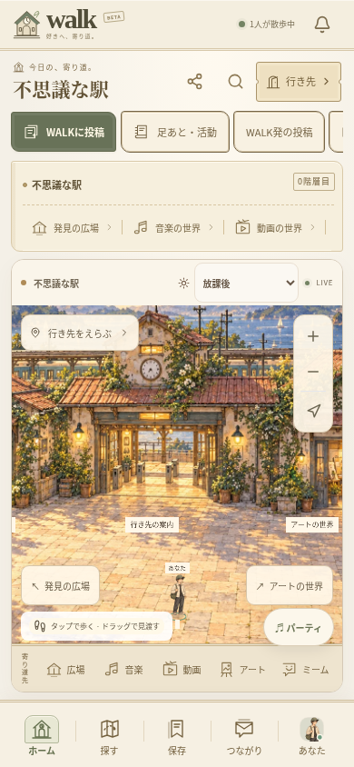
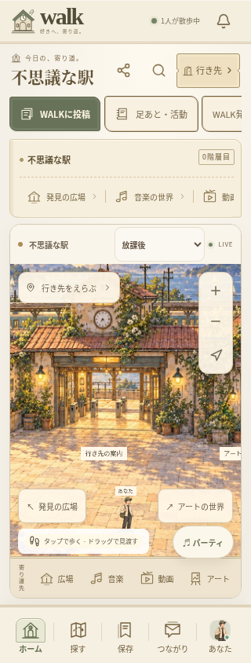
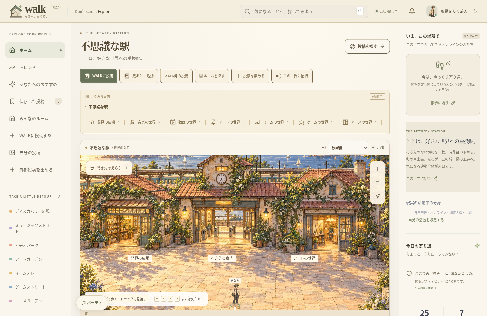

# ロゴと上下の駅のUI — 検証記録（2026-10-15）

仕様は [STATION_UI.md](STATION_UI.md)。ユーザーが囲んだロゴ、上部の操作、カテゴリー、スマホ下部のナビを対象にした更新。WALK以外のルートのサイトは変更していない。

## 実行した検証

- TypeScriptの型チェック・ESLint・Viteビルド成功。新しい依存パッケージや外部フォントは不要。
- 既存のユニットテスト79件／16ファイルが成功。
- ブラウザの全体検証25件が成功。従来23件と、今回追加した320px / 390pxの上下の操作2件。
- 今回のロゴ・現在地・投稿・行き先・カテゴリー・下部ナビの押せる範囲が44px以上あり、画面全体に縦横のはみ出しがなく、地図が下のナビに隠れず高さ240px以上あることを、320px / 390px・高さ844pxで検証。
- 新しい地図・駅舎・肖像のアイコンから、投稿検索・プロフィール・音楽の世界・駅へ実際に操作し、選択状態と行き先の表示を確認。
- 下のナビ・カテゴリーの小さな文字の色を濃くした後、対象の5件を再実行。実際に描画されたラベルと背景のコントラスト比が4.5以上あることを、スタイルの継承を含めて確認する検証を追加。
- 既存のクリック位置・ドラッグの区別・複数ユーザーの移動・閲覧人数・次へ進む操作、ルームと権限、実際の音声、投稿・動画、同期視聴、自室・大画面での再生継続、活動の分身・足あと、アカウント・通報対応も、全体検証で確認。
- 自動テストは一時データベースとテスト用ゲストを使用。既存の `.env`、`data/`、ユーザー投稿は削除していない。

WebRTC音声を含む全体検証は、この環境の既存のローカルTURNハーネスを使用。Chromiumの管理ポリシーは変更していない。

```sh
cd /workspace/muzui/walk
npm run typecheck
npm run lint
npm test
WALK_TEST_TURN_BIN=/tmp/walk-turn/extracted/usr/bin/turnserver \
WALK_TEST_TURN_LIB=/tmp/walk-turn/extracted/usr/lib/x86_64-linux-gnu \
npm run test:e2e:relay
npm run test:e2e -- tests/e2e/station-chrome.spec.ts tests/e2e/world-art.spec.ts
```

`/tmp` のTURNパスは、この準備済み環境で使ったもの。ブラウザテストは専用の一時サーバーを起動する。クラウドのlocalhostをユーザー向けの公開プレビューとして案内しない。

## 実装画面

参考のデザイン画像ではなく、実際に動かしたアプリの撮影。人数はテスト用ゲストの実際の状態であり、本番利用人数ではない。スマホ画像はタッチ対応のブラウザ環境で、ネイティブ実機の撮影ではない。

| 390px | 320px |
| --- | --- |
|  |  |



## 残る確認

iOS / Androidの実機でのsafe-area・文字の大きさ・長時間利用、VoiceOver / TalkBackの実際の読み上げ、iOSのコンパイル、ストアでの配布は別工程。ボタンの名前と階層をHTMLで保持し、装飾のSVGを読み上げから除いたことと、実機の読み上げ検証が完了したことを区別する。

新しいロゴはアプリ内の共通表示。ストア掲載用画像やホーム画面のランチャーアイコンを全て更新し終えたわけではない。自由建築や経済などの将来構想も今回の完成範囲に含めない。

## スマホ向けの反映

最終の調整後の5件も全件成功。`npx cap sync` でiOS / Androidへ6プラグインと最新のWeb UIを同期し、Web・Android・iOSのHTML / JavaScript / CSS 16ファイルのSHA-256一致を確認した。JDK21 / Android SDK36で `:app:assembleDebug` も成功（186タスク、21実行、165再利用）。同期とAndroidの開発用ビルドを、iOSコンパイル・実機検証・ストア公開とは区別する。
