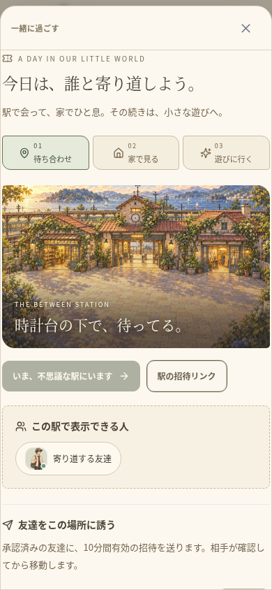
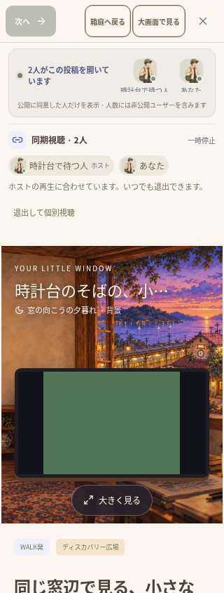
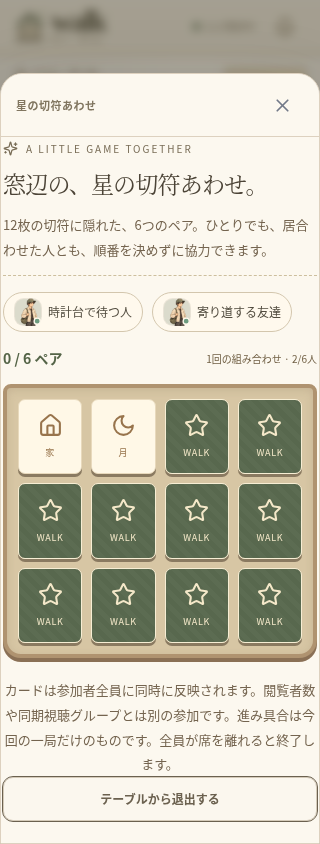

# 駅から家、次の遊びへ — 検証記録（2026-10-16）

仕様は [TOGETHER_JOURNEY.md](TOGETHER_JOURNEY.md)。WALK以外のルートサイトは変更せず、既存の世界・個人ルーム・招待・同期視聴をつないだ。ユーザーが共有した生活世界の構想は `PRODUCT_DIRECTION.md` に保存した。

## 確認結果

- TypeScript・ESLintが成功。ユニットテスト91件／18ファイルが成功。追加した協力ゲームの6件を含む。
- ゲームのテストは実際のSocket.IOクライアントを使用。同意と現在地の確認、他人のルームへのアクセス拒否、裏向きのカードの非開示、同時操作と更新番号、偽造操作の拒否、2人で全ペアを揃える操作と次の一局、別タブの重複参加拒否、6人の上限と空席、移動・切断・ブロック・非公開化での退出を確認。
- ゲーム参加でこの画面の閲覧を終了し、投稿の閲覧人数とゲーム参加人数を分けることを確認。ゲームの人数やカードの結果を架空の利用実績で補っていない。
- 新規のブラウザ検証は390pxと320pxの独立したセッションを使用。駅への招待を確認し、家を作って公開・動画を配置し、訪問者も窓辺へ入り、同じ動画を見て、さらに同意付きで再生位置を合わせ、その後にゲームの世界へ招待・移動・同意して参加する操作が成功。
- 訪問者に家の配置編集ボタンが出ないこと、投稿の閲覧者が実際に2人になること、同期グループが別に2人になること、各自の同意前にはゲームへ入らないことを確認。カードの選択を互いの画面に反映し、退出後に実際の参加人数が減ることを確認。
- 既存の自室視聴・プレーヤー保持3件と、320px／390pxの駅の操作2件が成功。
- 音声中継付きの全体ブラウザ検証27件がすべて成功（6.9分、失敗・スキップなし）。従来26件と新規の一日の流れ1件。フレンド・チャット、通報・利用停止、共有と招待、住人の世界、実動画と視聴モード保持、実WebRTC音声、同期視聴、活動と足あと、アカウントとデータ管理を含む。
- 視聴画面の案内位置・カードの色・キーボード操作を整えた後、自室のスマホ視聴と新規の流れの2件を再実行して成功（1.6分）。タブの矢印キー／Homeキー操作、同期中の実再生からの退出、個別視聴を閉じたときの動画要素の停止も確認。
- `npx cap sync` が成功し、iOS・Androidの各6プラグインへ同期。Androidの `:app:assembleDebug` が成功（20秒、186タスク、21実行・165は既存の出力を再利用）。APKのCRCを検証し、全42個のWeb素材のSHA-256が、Web版・Android・iOS・APK内部で一致。

最初の通し検証では、テストの招待画面名を実際の名前へ修正。その後、窓辺の画面が同期視聴の受信ボタンを隠す問題を発見した。視聴中は招待を視聴パネル内へ置き、キーボードのフォーカス範囲にも含めた。別の確認画面を開いている間は、受信ボタンを重ねて表示しない。

「次の遊びへ」の案内は視聴内容と一緒にスクロールする場所へ置き、動画を覆わないようにした。手元のゲームのカードは44px以上あり、狭い画面での横のはみ出しがないことを確認。風景上の文字とカードの色、実際の窓辺・ゲーム画面も目視した。

## 実装画面

検証用のゲストと、そのユーザーが直接投稿したテスト映像を実際に使ったブラウザ画面。本番の人数や利用実績ではなく、ネイティブ実機の撮影でもない。

| 駅で待ち合わせ | 同じ家で同期視聴 | 次の協力ゲーム |
| --- | --- | --- |
|  |  |  |

## 手順と環境

```sh
cd /workspace/muzui/walk
npm run typecheck
npm run lint
npm test
WALK_TEST_TURN_BIN=/workspace/.tools/walk-apt/cache/extracted/usr/bin/turnserver \
WALK_TEST_TURN_LIB=/workspace/.tools/walk-apt/cache/extracted/usr/lib/x86_64-linux-gnu \
npm run test:e2e:relay
npm run test:e2e -- tests/e2e/together-journey.spec.ts tests/e2e/room-watching.spec.ts --grep 'two phone users|touch'
```

ブラウザは既存の一時サーバーと一時SQLiteを使用。既存の `.env`、`data/`、ユーザー投稿、バックアップは削除していない。新しい依存パッケージやDBの初期化は不要。ゲームの進行はメモリ上で、再起動・全員退出で終了する。

今回の環境のTURN・JDK21・SDK36とJava用プロキシの設定は [前回の検証記録](VALIDATION_RESIDENT_WORLDS_2026-10-16.md) と保存済みの環境起動手順を再利用する。Chromiumの管理ポリシーやTLS検証は変更しない。クラウド内のlocalhostを公開プレビューとして案内しない。

## 残る範囲

今回のゲームは一つの場所に一つの小さな協力テーブル。永続的な成績、通貨、報酬、課金、負荷試験を実装・検証したものではない。カジノ・討伐・自由建築・仕事や収益化・恋愛向けの専用機能は別工程。iOSのコンパイル、両OSの実機、ストア署名・公開、公開HTTPSバックエンドの運用も今回の成功に含めない。
