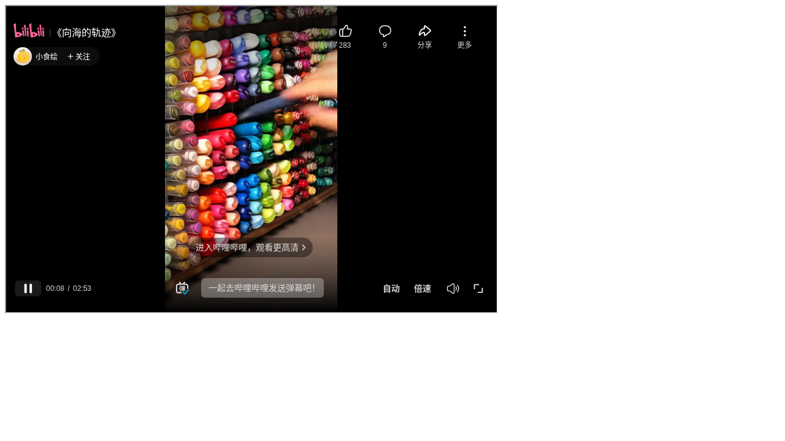
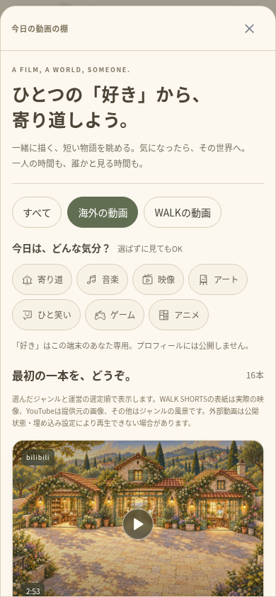

# 動画収集と初期ライブラリ — 検証記録（2026-10-17）

[収録一覧・一括再確認](VIDEO_LIBRARY.md)、[実測JSON](verification/VIDEO_CHECKS_2026-10-17.json)を参照。16本の実動画の観測、WALKの操作検証、後からの再確認失敗を別に記録する。

## 外部の実動画

| 項目 | 実測結果 |
| --- | --- |
| 公開カテゴリーから選んだ候補 | 30本 |
| 公式iframeで実動画の冒頭が進んだ候補 | **16本** |
| 未確認の候補 | **14本**。初期データへ入れていない |
| 収録後の初期動画棚 | WALK13本＋外部16本＝**29本**（新規DB） |
| WALKからの最初の実接続再確認 | 3本とも503で未確認 |
| 通信回復後のWALK再確認 | 映像・情報を読めたものもあったが停止状態。時刻の進行は未確認 |

公式のbilibili公開ページから候補URLを選び、公式の外部プレーヤー資料を閲覧した。最初の18本は2件並行で確認し、16本で映像サイズ・readyState・エラーなし・4秒以上の進行を観測した。1本はバッファ待ち後に3.78秒まで進んだが確認窓内の進行量が足りず未確認、1本はvideo要素待ちで時間切れだった。続く料理・動物・ゲームの12本は読み込めず未確認とした。

確認中にプレーヤーの資料ページにも503が出た。本文は接続経路の `upstream connect error` と `cloudflare_https_tunnel` を示した。他の公式サイトとGitHubは200だったため、すべての外部通信が停止したとは扱わない。いったん200へ戻った後、WALKの画面からも確認したが、ロード後の停止が続いた。再生ボタンの操作・読み込み待ち・大画面の手順を調整した後の実接続では、再び503となった。ログイン・アクセス確認を回避する操作はしていない。

方法を確かめた最初のゲームPV1本は別枠で、初期16本・候補30本に含めない。元動画の全編視聴・あらゆる地域や端末の再生・WALK内での全件成功を確認したとは扱わない。

## 型・API・ブラウザ

- TypeScript・ESLint・本番Webビルド成功。
- ユニット **139件／26ファイルすべて成功**（54.34秒）。URL・回の検証、出典と実測データ、同期不可、重複、既存データの保持、削除済み投稿を戻さないことの新しい5件を含む。
- 最初の全139件では137件成功・2件失敗。既存の初期件数38件を固定していた2件を、新しい収録件数を含む期待値へ更新し、全139件を再実行して上記の成功を確認した。
- 関連ブラウザ19件では **18件成功**（3.8分）。新しい1件は動画棚から既に大画面で開くのに、小画面向けボタンを探して時間切れとなった。次の修正でもボタン名を誤っており、実装の「箱庭と見る」に合わせた。
- 修正後の新しい2件は成功（26.6秒）。プレーヤーへ通常の再生権限を渡す最終コードでも **2件を再実行し、両方成功**（26.8秒）。19種類の成功を確認した記録で、最終コードで全19件をまとめて再実行したという意味ではない。

ブラウザは独立したSQLite・本物のFastify・セッション・WALK API・Socketで確認した。390px／320pxの動画棚、海外動画16件への絞り込み、出典・作者・実測時間、公式iframeの固定URL、自動再生オフ、明示操作前はiframeなし、大画面と箱庭を切り替えても同じDOMを維持すること、2人の実際のカード閲覧人数、非公開設定、同期なし、重複登録で上書きしないことを確認した。

ブラウザの外部プレーヤーだけは検証用HTMLへ置き換える。これは実動画の成功には数えない。実動画の16本は、別の実接続の記録に基づく。既存の次投稿・移動、WebRTC音声、オリジナルMP4の再生と同意付き同期、個人ルーム・再訪、抖音・YouTubeの導線も検証した。

## ネイティブ・保存内容

Android・iOS各6プラグインへの同期成功。Androidの最終debugビルド成功（13秒、186タスク、21実行・165再利用）。APKは **32,348,080バイト**、SHA-256は `8148f9ee84f1b78893a8f66d5eb3fb325d2e679a8119205d8b0ff8b3caf6d443`。

CRCは正常で、**61個**のWeb素材のSHA-256がWeb・Android・iOS用コピー・APK内で一致。新しい依存・端末権限・DB移行は追加していない。追加したnpmスクリプトは `videos:verify`。動画ファイルを16本コピーしたものではなく、出典リンクと公式プレーヤーを追加する。クライアントとサーバーは同じ版へ更新する。

ルートの別サイト、既存の `.env`・`data/`・ユーザー投稿・バックアップを削除・初期化していない。利用者の既存の同じURLの投稿、作者・題名・公開先、お気に入り、運営が編集・削除した内容を保持する。iOSのコンパイル・両OS実機・ストア署名／公開、本番HTTPSは今回の成功に含めない。

## 画面

実際の外部プレーヤーの確認用ページ。bilibili上の「小食绘」さんの『向海的轨迹』が8秒まで進んだ時点で、模擬プレーヤーではない。WALKの本画面・実機の撮影ではない。



WALKの動画棚（390px）。海外の動画16本を選べる。ジャンルの風景を表紙に使い、元動画のサムネイルとは説明を分けている。



## 再実行

```sh
cd walk
npm run typecheck
npm run lint
npm test
npm run build
npm run videos:verify
```

`videos:verify` は実通信を行い、未確認・503・429を成功にせず終了コード1で返す。今回のWALK内実接続は未確認のため、このコマンドが全件成功したとは記録しない。通信が安定した後の追加確認を残す。
