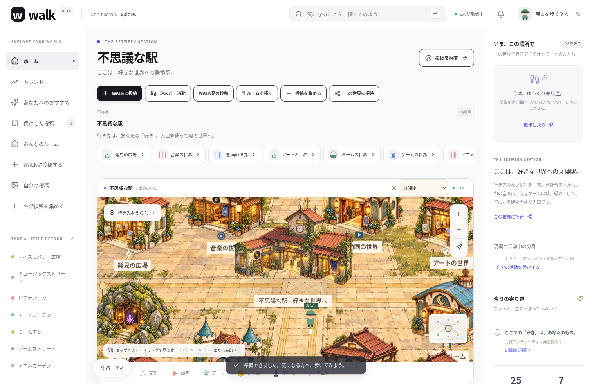
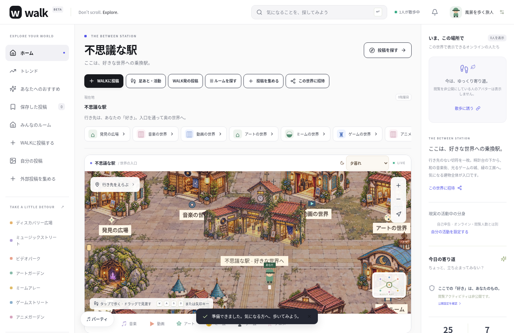
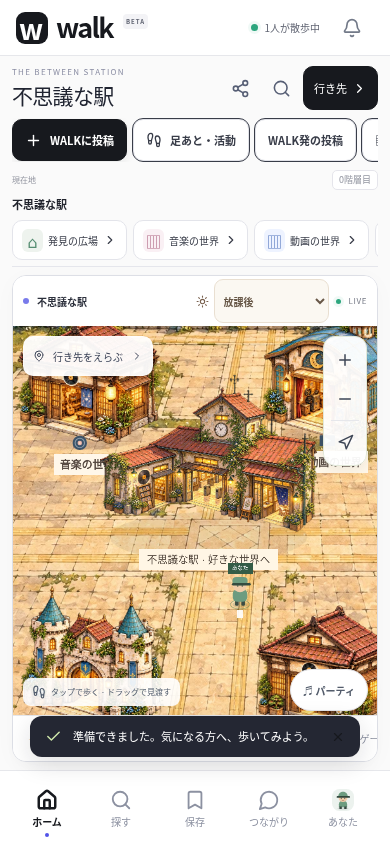
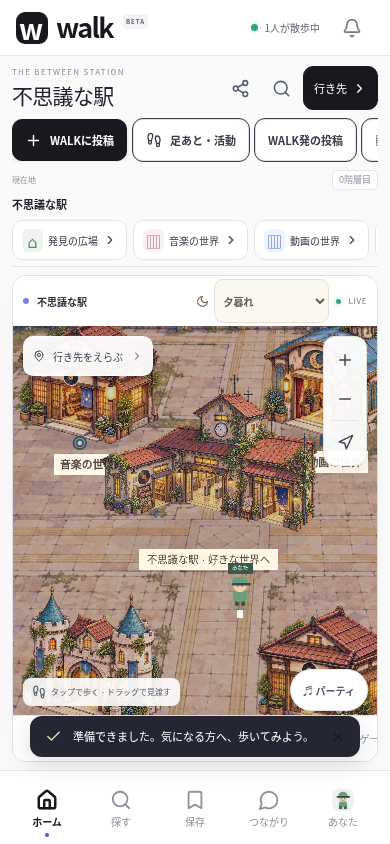
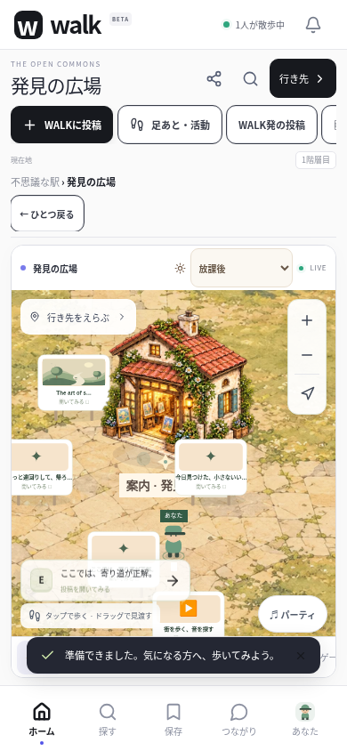
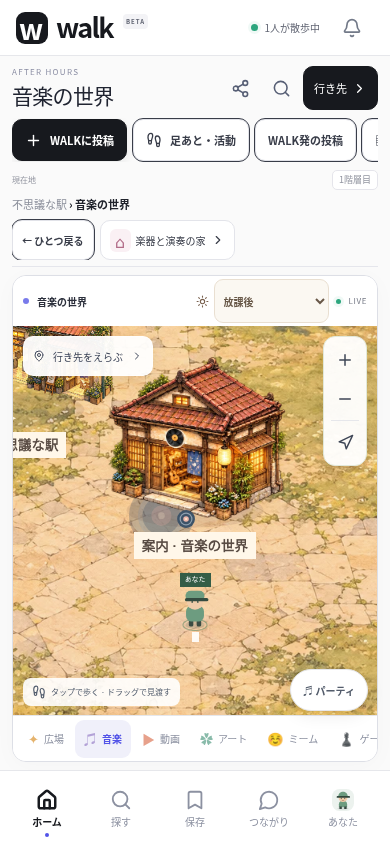
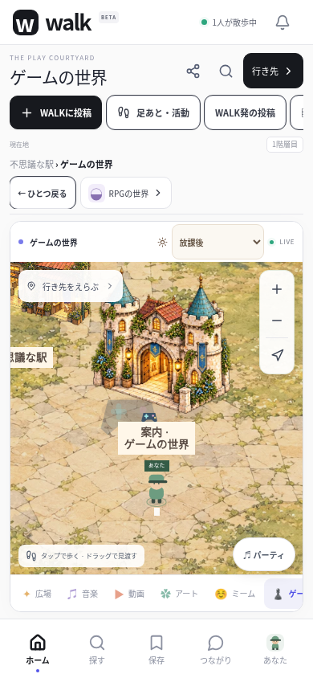
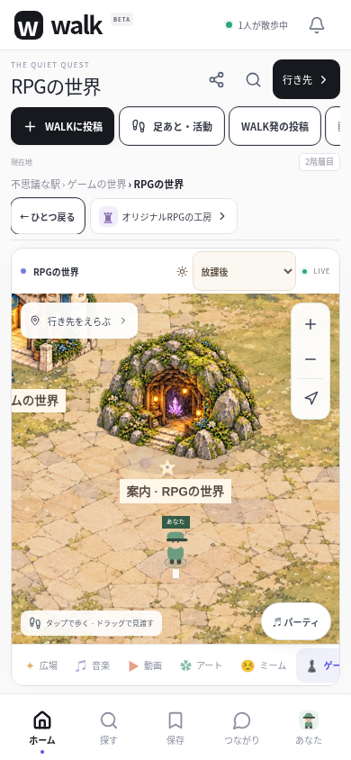

# 2026-10-15 駅・広場・移動先の描画の検証

Node.js 24 / Linux / Chromiumで `walk/` を検証した。ルートの別サイト、既存の `data/`・`.env`・ユーザー投稿は変更・削除していない。API・Socketイベント・DBスキーマ・依存宣言・lockfileの変更はない。

## 結果

- TypeScriptと本番Webビルド：成功。Playwright開始時に `npm run build` を実行した。
- ESLint：成功。
- ユニット・API・Socket.IO：15ファイル、77件成功。画像の不透明度に応じた入力判定と、手動・端末時刻による光の選択を追加して検証した。
- ブラウザ全体：テスト用ループバックTCP TURN付きで23ワークフロー成功、失敗・スキップなし。新しい世界描画の3件を追加した。
- 最後の入口の文字サイズ調整後：屋根・壁・足元・看板・城の塔、ズーム後の実際の投稿とアバター、全世界の表示と光、素材取得失敗時の操作を含む6件を再実行してすべて成功。ここに掲載する画面はこの最終実行で撮影したもの。
- ネイティブ素材：Capacitorの6プラグインとともにiOS / Androidへ同期成功。`index.html` と5枚のWebP（自室1枚、新しい箱庭4枚）のSHA-256がWeb・Android・iOSでそれぞれ一致した。
- Android：JDK 21 / SDK 36で `:app:assembleDebug` 成功。186タスク（21実行、165既存出力を使用）。ホームが読み取り専用のため既存の `/tmp/walk-android-user` を `ANDROID_USER_HOME` に指定した。

最初の全体実行では、ルームの既存テストがプロフィール保存の完了より先に再読み込みし、ようこそ画面が残る競合を検出した。テストでようこそ画面が実際に閉じるまで待つように修正し、タイムアウトを増やさず再実行して全23件が成功した。途中でスマホの到着直後の画角も実画面で確認し、地面だけでなくその世界の案内の建物が見えるよう調整した。

## 今回の描画・入力の確認

- PCと390px幅のタッチ環境で、駅の放課後／夕暮れを同じマップで選べる。光の切替でcanvas要素を作り直さず、実際の自分の座標が変化しない。
- 駅に加え、発見・音楽・動画・アート・ゲーム・RPG・オリジナルRPG・アニメ・楽器・アニメ制作・ミーム・学校・ジム・居酒屋の14か所を両環境で移動し、素材の取得と描画、選択した夕暮れの保持を確認した。
- 320px / 390pxで横にはみ出さず、再読み込み後にも光の選択を保持する。
- 建物の屋根・側面・実際の足元・看板、城の両側の塔をマウス／タッチで選び、該当世界へ移動する。ドラッグを入室にしない。拡大後の投稿看板・実ユーザーのアバターも見えている位置から選べる。
- 素材の読み込みを意図的に失敗させても、従来の描画で駅と行き先を利用できる。
- 全体回帰で、実際の投稿閲覧人数・公開同意、投稿の次送りとアバター移動、私的なルーム、自室の動画再生継続、同期視聴、チャットとブロック、音声の受信・ミュート・終了、活動中の分身と一日の記録、招待、アカウント管理も成功した。

WebRTCには既存のテスト用TURNを使った。この環境のChromiumは `disable_non_proxied_udp` の管理ポリシーがあり、直接接続を検証した結果とは区別する。外部埋め込みの要素保持はテスト用HTMLで確認し、外部サービスの実再生許可の確認とは扱わない。

## 実装画面

以下はアプリを動かして撮影した画面で、参考用の一枚絵ではない。登場するアバターと人数は、その検証のために接続したゲスト。投稿看板にサンプルを含み、本番の利用状況ではない。スマホ画像はブラウザのタッチ環境で、実機撮影ではない。

### 駅：放課後と夕暮れ

### 移動先

## 未実施の検証

iOSのコンパイル・署名、Android / iPhone実機のメモリ・描画速度・長時間移動・バックグラウンド復帰、実機の埋め込みや音声、ストア提出は未実施。公開HTTPSサーバーと運営者情報は引き続き未設定。ユーザーが開けるクラウドの公開プレビューは作成していない。

描画素材の再利用・自室の窓が静止背景であること・衝突や自由建築など未実装の範囲は [WORLD_GRAPHICS.md](WORLD_GRAPHICS.md) に記録している。
