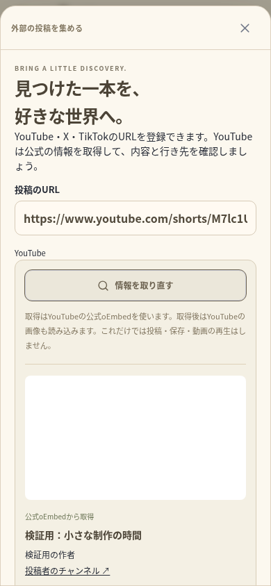
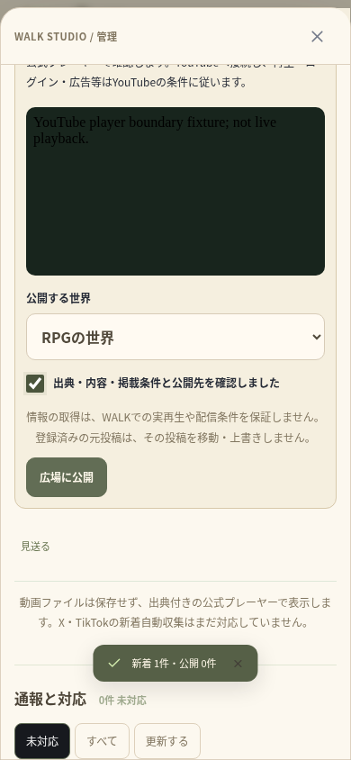

# YouTubeの持ち込み・候補確認 — 検証記録（2026-10-17）

変更は `walk/` のみ。ルートの別サイト、`.env`、既存の `data/`、投稿・バックアップを削除・初期化していない。[機能と実接続の制限](YOUTUBE_IMPORT.md)を参照。

## 結果

| 検証 | 結果 |
| --- | --- |
| TypeScript・ESLint・本番Webビルド | 成功 |
| ユニット | **120件／23ファイルすべて成功**（51.97秒）。新しい8件を含む |
| 新しいブラウザワークフロー | **3件すべて成功**（35.3秒） |
| 関連する既存ブラウザワークフロー | **12件すべて成功**（2.4分）、実TURN中継を使用 |
| Capacitor | Android・iOS各6プラグインへの同期成功 |
| Android debug APK | オフラインビルド成功（18秒、186タスク、21実行・165再利用） |
| 実YouTubeのoEmbed・Atomフィード | **プロキシの403で未確認** |

APKは **32,341,457バイト**、SHA-256は `02f1593e1a180fde6f579b9bb24154cd1dca6bcef8123d932c53f1ff6b33a474`。CRCが正常で、**61個**のWeb素材のSHA-256がWeb・Android・iOS用コピー・APK内部で一致した。新しい依存・DB移行・端末権限は追加していない。今回の取得APIを使うにはバックエンドも同じ版へ更新する。

## 新しく確認したこと

- 認証・入力検証、任意ホストへのアクセス防止、固定された公式取得URL、リダイレクト拒否、サイズ上限、Unicodeのチャンネル名、応答の必要項目への限定。
- 同時取得の共有とキャッシュ、取得失敗の再試行、上流エラーやプロキシ資格情報を利用者へ漏らさないエラー表示。
- 情報取得だけでは投稿・保存・視聴を開始しない。確認後に指定した奥の世界へ公開・保存し、元投稿の重複登録でも公開先・投稿者・題名を変えない。
- URL変更中の遅い取得結果を破棄し、失敗時は明示的な手入力で進める。登録中に閉じても、保存完了後に勝手に移動しない。
- 管理者による収集元の登録・新着取得・候補の確認・公開先の選択。公開先変更時のチェック解除、確認前の公開ボタン無効、同じ候補を二重公開しない。
- 390px・320pxでの横はみ出しなし。名前や閲覧状態の公開はオフのまま、同期視聴へ自動参加しない。

新しいブラウザ検証は独立した一時SQLiteと実際のFastify・認証・API・Socket移動・保存・公開を使う。**外部のoEmbed・フィードだけはプログラムから検証用応答を注入し、外部iframeと画像の境界も検証用表示へ置き換えた。実YouTubeの映像・画像を取得・再生できた証拠ではない。** 本番の環境変数やHTTP APIに模擬データを有効にするスイッチは追加していない。

追加テスト作成中に、非同期JSONの読み忘れ、selectのラベル一致、Socket接続を残したサーバー終了処理を修正した。上の3件の結果はその修正後の実行。製品の通信制約を回避する変更はしていない。

既存12件では、複数ユーザーへの次投稿・移動の反映、実WebRTC音声の受信とマイク終了、オリジナルMP4再生と同意付き同期、直接アップロード、個人ルームの非公開・カメラ切替、外部プレーヤーのDOM維持、一人での保存・再訪、招待リンクと遅い応答・取り消しを確認した。ブラウザ全36件を今回まとめて実行したという記録にはしない。

## 検証用の画面

実装画面を390pxのブラウザで撮影したもの。題名・投稿者・画像は上記の検証用応答で、実機撮影・公開プレビュー・外部からの実取得ではない。白い画像部分も検証用の単色画像である。

| URLから情報を確認 | 収集した候補の公開前確認 |
| --- | --- |
|  |  |

[選んだ世界で投稿を開く画面](screenshots/youtube-world-390.png)

## 再実行

```sh
cd /workspace/muzui/walk
npm run typecheck
npm run lint
npm test
npm run test:e2e -- tests/e2e/youtube-import.spec.ts
WALK_TEST_TURN_BIN=/workspace/.tools/walk-apt/cache/extracted/usr/bin/turnserver \
WALK_TEST_TURN_LIB=/workspace/.tools/walk-apt/cache/extracted/usr/lib/x86_64-linux-gnu \
npm run test:e2e:relay -- tests/e2e/community.spec.ts tests/e2e/discovery.spec.ts tests/e2e/publishing.spec.ts tests/e2e/room-watching.spec.ts tests/e2e/watch-links.spec.ts tests/e2e/solo-time.spec.ts
```

この環境ではローカル待ち受けにも許可された実行を使用した。Chromiumの管理ポリシー・TLS検証は変更していない。実接続用ホストの環境設定下書きは保存済みだが、反映前なので実取得を再試行して成功と扱っていない。実YouTubeの再生・最新規約への適合確認、公開HTTPS、iOSコンパイル、両OS実機・署名・ストア公開、人による満足度・海外市場の需要は未確認。
