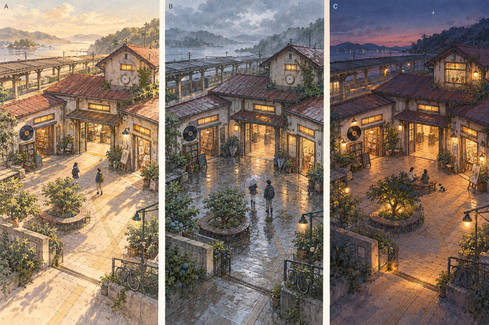
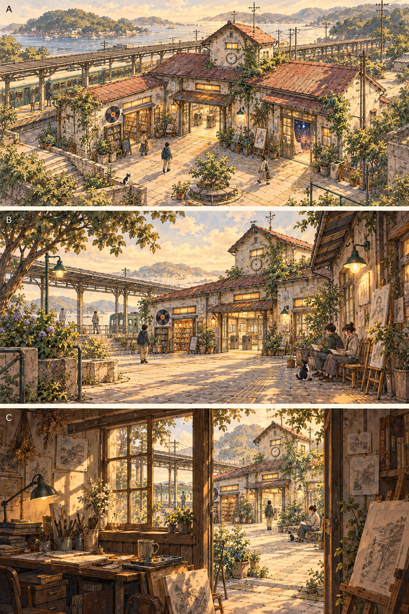
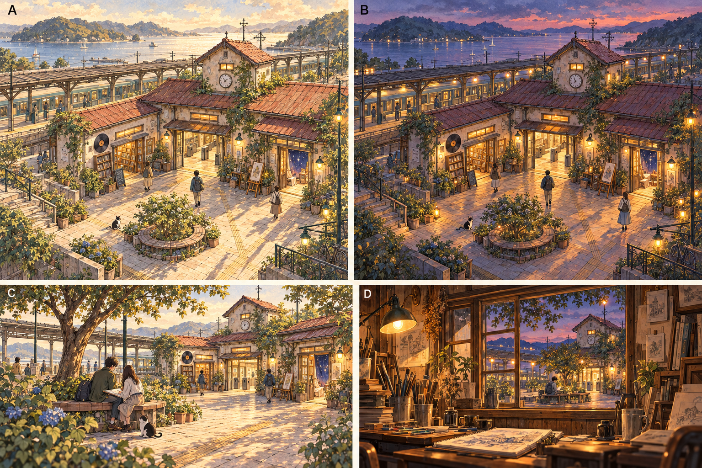
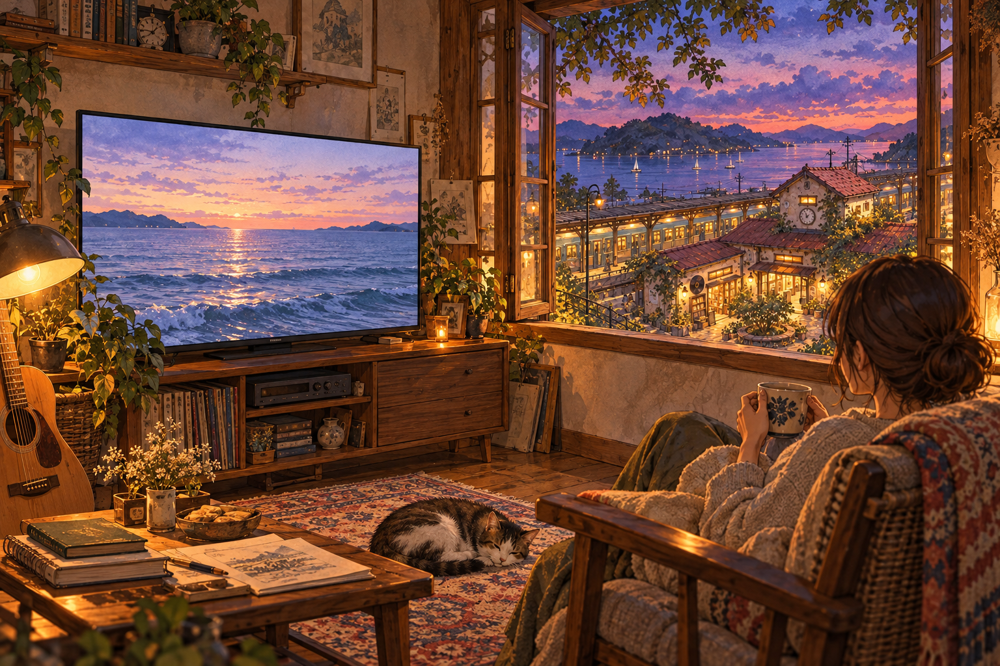

# WALK 世界観の参考画像

2026-10-15の対話で作成した、WALK用のオリジナル生成コンセプト画像です。実装画面ではありません。描かれた人物は構図を検討するためのもので、実際の利用者や閲覧者ではありません。

ユーザーは『ルックバック』の背景・光・日常の空気、線や色の質感、人物の感情・距離感・物語のすべてに加え、視点も好むと回答しています。その後、光・天気はAを基本に夕方にCの表情へ変わる方向、視点はAを基本に場所やタイミングで変化する方向を選びました。駅の最終形や切替条件はまだ未決定です。[決定事項と次の提案](../STATION_ART_DIRECTION.md)を参照してください。

チャットで画像が表示されなかったため、GitHubから直接開ける形でも保存しました。画像のプレビューが出ない場合は、画像のページで「Raw」またはダウンロードを選べます。

## 1. 光と天気の比較（横にA・B・C）

- A・左：放課後の柔らかい日差し。
- B・中央：雨に濡れた広場と暖かな室内。
- C・右：夕暮れの空と窓の灯り。

[光と天気の画像を開く](station-light-studies.png)

## 2. 視点の比較（上からA・B・C）

- A・上：斜め上から駅と入口を見渡す。普段の2.5D操作画面の検討に使う。
- B・中央：人の高さに近づき、人と広場の距離感を見せる。
- C・下：アトリエの窓・入口越しに広場を眺め、個人の居場所と共有空間をつなぐ。

[視点の画像を開く](station-viewpoint-studies.png)

## 3. 選ばれた方向を組み合わせた駅

新しい画像内の文字は、この画像だけの場面名です。最初の比較画像のA・Cとは別です。

- 左上・A：放課後。基本の見下ろし。
- 右上・B：同じ駅の夕暮れ。道と入口を保ちながら灯りがともる。
- 左下・C：ベンチのそばから、人と広場を眺める視点の提案。
- 右下・D：夕暮れの広場を、アトリエの窓越しに眺める視点の提案。

[選ばれた方向を組み合わせた画像を開く](station-selected-direction.png)

時間変化・見下ろしを基本にする方向はユーザー決定。下段の具体的な構図や場所、建物の最終形は引き続き提案であり、この絵どおりのカメラや素材はまだ実装していません。

## 4. 自室で動画を見る視点

ユーザーの「窓越しに広場を見る視点を、自分の家・部屋で動画を見るときに使いたい」という案から作成。室内の画面と窓の向こうの夕暮れの駅を、一緒に眺める構図です。家具・人物・猫は参考案で、実利用者ではありません。画面の海は動画内容の仮イメージであり、再生できる動画ではありません。

[自室の視聴イメージを開く](personal-room-watching.png)

この参考案を受けて、共通の夕暮れ背景に実際のプレーヤーを重ねる [自室の視聴モード](../ROOM_WATCHING.md) を実装しました。この絵をそのままアプリの画面として貼ったものではなく、人物・猫・テレビのない別の背景素材と実際の投稿を組み合わせています。家具の自由な変更や窓のリアルタイム表示は未実装です。

## 次に検討すること

選択された時間変化と基本視点を組み合わせて駅の案を絞る。参考絵のカメラ表現を、そのまま操作機能の実装済み仕様として扱わない。2.5Dの読み取りやすさ、建物全体のタッチ判定、実際の閲覧者の見分けやすさを保ち、スマホ画面のサイズで建物・小物・アバター・UIを検討する。
